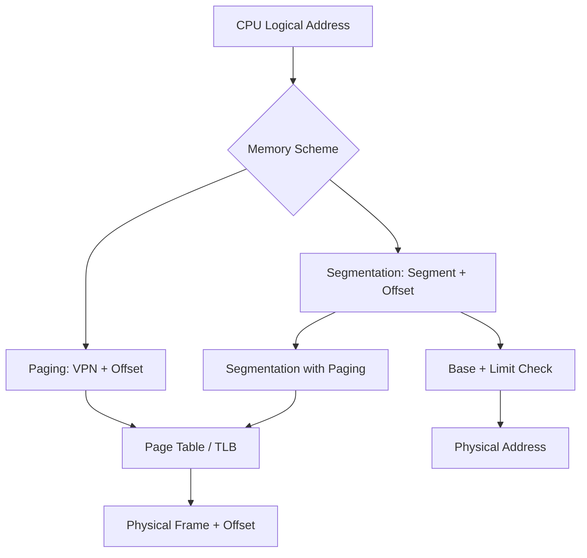
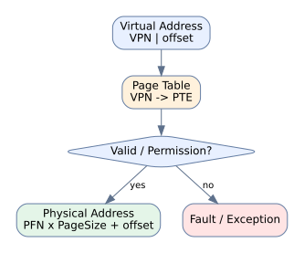
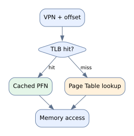
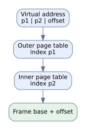
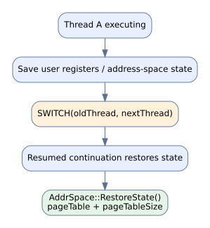
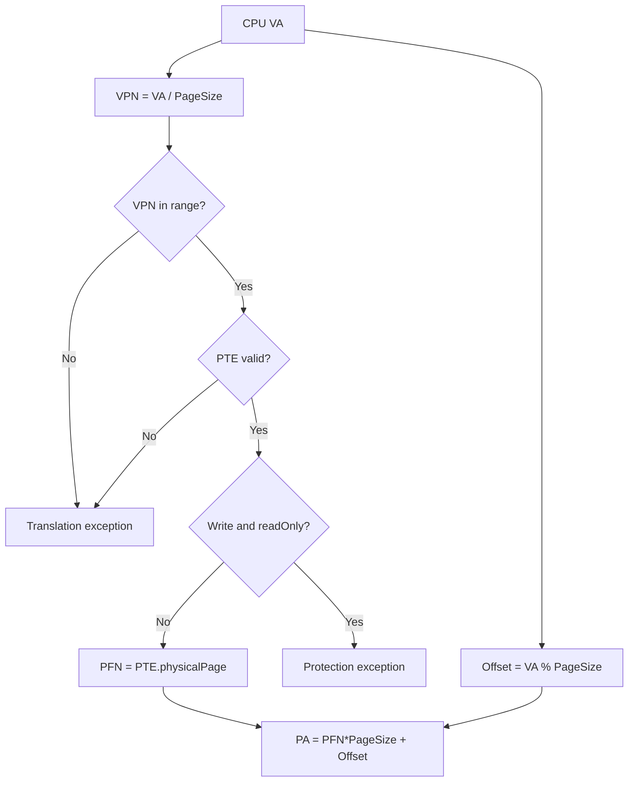
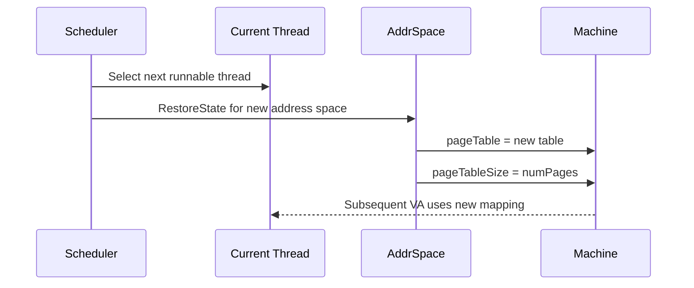

# NYCU OS LEC08 — Memory Management｜Canonical Learning Markdown v4.1（候選精修版）

> **CANDIDATE / HUMAN QA PENDING**。整合既有 v4.0 V2/V3 教材，避免平行維護。原始 PDF 僅供本機證據核對，未包含於本教材包。來源圖片已選頁視覺核對，其他頁面的圖像 QA 仍待人工逐頁檢查。

## 1. 學習目標與來源邊界

- 原始 PDF：LEC08，**78 頁**；以 PDF 頁序標示 p.N。
- NachOS baseline：[5ricarthuang/nycu-os](https://github.com/ericarthuang/nycu-os) 的 `nachos/NachOS/code`；此教材核對 GitHub baseline，**沒有執行現行 HW01 工作樹**。
- Learning Record：[# 26](https://github.com/myaiwouldbemine/myaiwouldbemine-Copy-Learning-Hub/issues/26)。
- 驗證層次：`PDF TEXT CHECKED`、`SELECTED FIGURE VISUALLY CHECKED`、`CODE VERIFIED (GitHub)`、`DERIVED`、`RUNTIME NOT RUN`；不要把不同層次混稱 PASS。

## 2. 原始 PDF 逐頁來源核對（78/78 文字層）

以下每頁皆以原始 PDF 文字層重新核對。**圖像或公式無文字層時，不會推測圖中的箭頭或數值**；特定重要圖已以原始投影片影像人工查看後重繪。表中未標示 VISUALLY CHECKED 的圖像仍屬待驗證。

| PDF 頁 | 核對到的原始文字／公式線索 | 本次核對狀態 |
|---|---|---|
| 01 | Department of Computer Science Operating Systems Lecture 08: Memory Management Shuo-Han Chen… | TEXT CHECKED；FIGURE QA PENDING |
| 02 | Course Schedule W Date Lecture Note Homework 1 Sept. 9 Lec00: Couse Overview & Historical Pr… | TEXT CHECKED；FIGURE QA PENDING |
| 03 | Overview • Background • Swapping • Contiguous Allocation • Paging • Segmentation • Segmentat… | TEXT CHECKED；FIGURE QA PENDING |
| 04 | Background • Main memory and registers are the only storage CPU can access directly • Collec… | TEXT CHECKED；FIGURE QA PENDING |
| 05 | Outline • How to refer memory in a program? • address binding • How to load a program into m… | TEXT CHECKED；FIGURE QA PENDING |
| 06 | Multistep Processing of a User Program 6 | TEXT CHECKED；FIGURE QA PENDING |
| 07 | Address Binding – Compile Time • Program is written as symbolic code • Compiler translates s… | TEXT CHECKED；FIGURE QA PENDING |
| 08 | Address Binding – Load Time • Compiler translates symbolic code into relocatable code • Relo… | TEXT CHECKED；FIGURE QA PENDING |
| 09 | Address Binding – Execution Time • Compiler translates symbolic code into logical-address (i… | TEXT CHECKED；FIGURE QA PENDING |
| 10 | Memory-Management Unit (MMU) • Hardware device that maps virtual to physical address • The v… | TEXT CHECKED；FIGURE QA PENDING |
| 11 | Logical vs. Physical Address • Logical address – generated by CPU • a.k.a. virtual address •… | TEXT CHECKED；FIGURE QA PENDING |
| 12 | Outline • How to refer memory in a program? • address binding • How to load a program into m… | TEXT CHECKED；FIGURE QA PENDING |
| 13 | Dynamic Loading • The entire program must be in memory for it to execute? • No, we can use d… | TEXT CHECKED；FIGURE QA PENDING |
| 14 | Dynamic Loading Example in C • dlopen(): opens a library and prepares it for use • desym(): … | TEXT CHECKED；FIGURE QA PENDING |
| 15 | Dynamic Loading Disk image Memory content Init After B() called After C() called After C() e… | TEXT CHECKED；FIGURE QA PENDING |
| 16 | Static Linking Memory • Static linking : libraries are combined by the loader into the main … | TEXT CHECKED；FIGURE QA PENDING |
| 17 | Memory Dynamic Linking main () stub • Dynamic linking : Linking postponed until execution ti… | TEXT CHECKED；FIGURE QA PENDING |
| 18 | Review Slides (1) • 3 types of address binding? • compile-time • load-time • execution-time … | TEXT CHECKED；FIGURE QA PENDING |
| 19 | Outline • How to refer memory in a program? • address binding • How to load a program into m… | TEXT CHECKED；FIGURE QA PENDING |
| 20 | Swapping • A process can be swapped out of memory to a backing store, and later brought back… | TEXT CHECKED；FIGURE QA PENDING |
| 21 | Swapping (cont’d) • Swap back memory location • If binding is done at compile/load time • ->… | TEXT CHECKED；FIGURE QA PENDING |
| 22 | Process Swapping to Backing Store • A major part of swap time is transfer time; total transf… | TEXT CHECKED；FIGURE QA PENDING |
| 23 | Outline • How to refer memory in a program? • address binding • How to load a program into m… | TEXT CHECKED；FIGURE QA PENDING |
| 24 | Contiguous Memory Allocation 24 | TEXT CHECKED；FIGURE QA PENDING |
| 25 | Memory Allocation • Fixed-partition allocation: • Each process loads into one partition of f… | TEXT CHECKED；FIGURE QA PENDING |
| 26 | Multiple Partition (Variable-Size) Method • When a process arrives, it is allocated a hole l… | TEXT CHECKED；FIGURE QA PENDING |
| 27 | Dynamic Storage Allocation Problem • How to satisfy a request of size n from a list of free … | TEXT CHECKED；FIGURE QA PENDING |
| 28 | Fragmentation External 0 Internal 0 • External fragmentation OS OS 300 250 • Total free memo… | TEXT CHECKED；FIGURE QA PENDING |
| 29 | Review Slides (2) • Swapping? • Contiguous memory allocation? • fixed-size memory allocation… | TEXT CHECKED；FIGURE QA PENDING |
| 30 | Non-Contiguous Memory Allocation — Paging 30 | TEXT CHECKED；FIGURE QA PENDING |
| 31 | Paging Concept • Method: • Divide physical memory into fixed-sized blocks called frames • Di… | TEXT CHECKED；FIGURE QA PENDING |
| 32 | Paging Example • Page table: • Each entry maps to the base address of a page in physical mem… | TEXT CHECKED；FIGURE QA PENDING |
| 33 | Address Translation Scheme • Logical address is divided into two parts: • Page number (p) • … | TEXT CHECKED；FIGURE QA PENDING |
| 34 | PageSize=1024, VPN=2, offset=20, PFN=5 -> PA=5140（與教材例題核對；圖中表項仍須核對） | TEXT / FORMULA CHECKED；視覺註記另列 |
| 35 | Address Translation • Total number of pages does not need to be the same as the total number… | TEXT CHECKED；FIGURE QA PENDING |
| 36 | Free Frames 36 | TEXT CHECKED；FIGURE QA PENDING |
| 37 | Page / Frame Size • The page (frame) size is defined by the hardware • Typically a power of … | TEXT CHECKED；FIGURE QA PENDING |
| 38 | Paging Summary • Paging helps separate user’s view of memory and the actual physical memory … | TEXT CHECKED；FIGURE QA PENDING |
| 39 | PTBR；單層頁表無 TLB 時每次 memory reference 需要兩次 memory reads | TEXT / FORMULA CHECKED；視覺註記另列 |
| 40 | TLB associative lookup（延遲參數依後續投影片） | TEXT / FORMULA CHECKED；視覺註記另列 |
| 41 | TLB hit/miss 與 EAT（確認參數／計數模型） | TEXT / FORMULA CHECKED；視覺註記另列 |
| 42 | TLB EAT：20ns lookup、100ns memory，h=0.70/0.98 -> 150ns/122ns（依既有教材計算；逐頁參數定位需再審） | TEXT / FORMULA CHECKED；視覺註記另列 |
| 43 | Review Slides (3) • memory frame? page? typical page size? • page table? virtual -> physical… | TEXT CHECKED；FIGURE QA PENDING |
| 44 | Memory Protection • Each page is associated with a set of protection bits in the page table … | TEXT CHECKED；FIGURE QA PENDING |
| 45 | Valid-Invalid Bit Example • Potential issues: • Un-used page entry cause memory waste -> use… | TEXT CHECKED；FIGURE QA PENDING |
| 46 | Shared Pages • Paging allows processes to share common code, which must be reentrant • Reent… | TEXT CHECKED；FIGURE QA PENDING |
| 47 | Shared Pages by Page Table • Shared code must appear in the same location in the logical add… | TEXT CHECKED；FIGURE QA PENDING |
| 48 | 32-bit VA、4KB pages：2^20 PTE × 4 bytes = 4MB | TEXT / FORMULA CHECKED；視覺註記另列 |
| 49 | Hierarchical Paging • Break up the logical address space into multiple page tables • Paged t… | TEXT CHECKED；FIGURE QA PENDING |
| 50 | Two-Level Page Table Example 212 210 000100 001000 210 101100 50 | TEXT CHECKED；FIGURE QA PENDING |
| 51 | Two-Level Address Translation 51 | TEXT CHECKED；FIGURE QA PENDING |
| 52 | 圖像核對：p1=3 bits、p2=4 bits、offset=5 bits；範例位址以彩色位元標記，須依圖逐段解讀 | TEXT + SELECTED FIGURE VISUALLY CHECKED |
| 53 | 階層頁表的空間／存取權衡 | TEXT / FORMULA CHECKED；視覺註記另列 |
| 54 | Hashed Page Table • Commonly-used for address > 32 bits • Virtual page number is hashed into… | TEXT CHECKED；FIGURE QA PENDING |
| 55 | Hashed Page Table Address Translation 55 | TEXT CHECKED；FIGURE QA PENDING |
| 56 | Improved Hashed Page Table Implementation 56 | TEXT CHECKED；FIGURE QA PENDING |
| 57 | Inverted Page Table • Maintains NO page table for each process • Maintains a frame table for… | TEXT CHECKED；FIGURE QA PENDING |
| 58 | Inverted Page Table Addr Translation 58 | TEXT CHECKED；FIGURE QA PENDING |
| 59 | Review Slides (4) • memory protection by page table? • valid, invalid bits? • page table mem… | TEXT CHECKED；FIGURE QA PENDING |
| 60 | Non-Contiguous Memory Allocation — Segmentation 60 | TEXT CHECKED；FIGURE QA PENDING |
| 61 | Segmentation • Memory-management scheme that supports user view of memory • A program is a c… | TEXT CHECKED；FIGURE QA PENDING |
| 62 | Logical View of Segmentation 62 | TEXT CHECKED；FIGURE QA PENDING |
| 63 | Segmentation Table • Logical address: (seg#, offset) • Offset has the SAME length as physica… | TEXT CHECKED；FIGURE QA PENDING |
| 64 | Segmentation Hardware • Limit register is used to check offset length • MMU allocate memory … | TEXT CHECKED；FIGURE QA PENDING |
| 65 | Address Translation Comparison • Segment • Table entry: (segment base addr. , limit ) • Segm… | TEXT CHECKED；FIGURE QA PENDING |
| 66 | Example of Segmentation 66 | TEXT CHECKED；FIGURE QA PENDING |
| 67 | Sharing of Segments 67 | TEXT CHECKED；FIGURE QA PENDING |
| 68 | Protection & Sharing • Protection bits associated with segments • Read-only segment (code) •… | TEXT CHECKED；FIGURE QA PENDING |
| 69 | Segmentation with Paging 69 | TEXT CHECKED；FIGURE QA PENDING |
| 70 | Basic Concept • Apply segmentation in logical address space • Apply paging in the physical a… | TEXT CHECKED；FIGURE QA PENDING |
| 71 | Address Translation • CPU generates logical address • Given to segmentation unit • -> produc… | TEXT CHECKED；FIGURE QA PENDING |
| 72 | Example: The Intel Pentium • Logical address space is divided into 2 partitions: • 1st: 8K(2… | TEXT CHECKED；FIGURE QA PENDING |
| 73 | Intel Pentium Segmentation • Segment descriptor • Segment base address and length • Access r… | TEXT CHECKED；FIGURE QA PENDING |
| 74 | Intel Pentium Paging (Two-Level) • Page size can be either 4KB or 4MB • Each page directory … | TEXT CHECKED；FIGURE QA PENDING |
| 75 | Segment + Paging 圖像例題；原圖的 segment/page entry 數值仍需人工完整核對 | TEXT + SELECTED FIGURE VISUALLY CHECKED |
| 76 | Review Slides (5) • Segmentation vs. Paging? Paging segmentation Length Fixed Varied Fragmen… | TEXT CHECKED；FIGURE QA PENDING |
| 77 | Reading Material & HW • Chap 8 • Problem Set: • 8.1, 8.3, 8.4, 8.5, 8.12, 8.17, 8.20, 8.23 7… | TEXT CHECKED；FIGURE QA PENDING |
| 78 | Q&A Thank you for your attention | TEXT CHECKED；FIGURE QA PENDING |

## 3. 概念整合與逐頁教學（V2 方法融入）


> **完整教學草稿，不是已驗證定稿。** 本文件逐頁對照取得的 78 頁講義。所有「p.」指 PDF 實際頁序。圖形密集頁的圖中數值須以原始 PDF 視覺核對；沒有假裝從圖形讀出未驗證的資料。既有 NYCU_OS 學習紀錄是歷史脈絡，不等於本次重新查證原始碼。

### 學習目標與路徑

1. 辨認三種 address binding、logical/physical address 及 MMU。
2. 分辨 dynamic loading / linking、swapping 與 allocation 的不同層次。
3. 手算 paging、TLB EAT、多層頁表與 segmentation。
4. 比較 page table 結構、保護、共享與碎裂問題。
5. 在適當節點回訪 LR04、Foundation F10、HW01 與 LR05，而非僅附上連結。

### 一頁式觀念地圖



### 逐頁講義整理（78/78 頁）

#### A｜背景、位址繫結、動態載入與連結（pp. 1–18）

- **p.01 — Department of Computer Science**：封面：NYCU Operating Systems Lecture 08，Memory Management。
- **p.02 — Course Schedule**：課程表將 Lec08 排在 Lec09 Virtual Memory 前；對應 HW01。
- **p.03 — Overview**：全章六大主題：背景、Swapping、Contiguous Allocation、Paging、Segmentation、Segmentation with Paging。
- **p.04 — Background**：CPU 直接存取主記憶體／暫存器；多程式併存與磁碟換入換出是記憶體管理動機。
- **p.05 — Outline**：四條主線：位址繫結、載入與連結、Swap、記憶體配置。
- **p.06 — Multistep Processing of a User Program**：圖示描述 source → compile → link → load → execution 的多階段處理；需看原圖辨認箭頭。
- **p.07 — Address Binding – Compile Time**：Compile-time binding：絕對位址在編譯時確定；起始位置改變通常需重編。
- **p.08 — Address Binding – Load Time**：Load-time binding：relocatable code 在載入時決定實際位置；移動通常需重新載入。
- **p.09 — Address Binding – Execution Time**：Execution-time binding：執行時使用 logical address，靠 MMU 動態轉換。
- **p.10 — Memory-Management Unit (MMU)**：MMU 利用 relocation/base 類機制把虛擬位址映射至實體位址。
- **p.11 — Logical vs. Physical Address**：Logical address 由 CPU 產生；physical address 是記憶體系統使用的位址。
- **p.12 — Outline**：本頁重述四條課程主線。
- **p.13 — Dynamic Loading**：Dynamic loading：不必在一開始把所有程式模組都載入；依呼叫需求載入。
- **p.14 — Dynamic Loading Example in C**：以 C 動態函式庫 API 示範執行期載入與查詢符號；需區分載入與連結。
- **p.15 — Dynamic Loading**：圖示比較函式 B、C 被呼叫前後的磁碟映像與記憶體內容。
- **p.16 — Static Linking                                                       Memory**：Static linking：程式與函式庫於連結階段合併；執行檔較獨立但可能重複。
- **p.17 — Memory**：Dynamic linking：stub 與執行期連結器讓共用函式庫延後解析。
- **p.18 — Review Slides (1)**：Review (1)：address binding、logical/physical、dynamic/static loading 與 linking。

#### B｜Swapping 與連續記憶體配置（pp. 19–29）

- **p.19 — Outline**：課程轉場至 swapping。
- **p.20 — Swapping**：Swapping：程序可暫時搬至 backing store，再回主記憶體續執行。
- **p.21 — Swapping (cont’d)**：Swap-in 位置與 address binding 時機有關；execution-time relocation 較彈性。
- **p.22 — Process Swapping to Backing Store**：Swap 耗時主要受搬運資料量與傳輸時間影響。
- **p.23 — Outline**：課程轉場至 allocation。
- **p.24 — Contiguous Memory Allocation**：連續配置主題封面。
- **p.25 — Memory Allocation**：Fixed partition：記憶體切成固定區塊；程序占用一個分割區。
- **p.26 — Multiple Partition (Variable-Size) Method**：Variable partition：從 free holes 中找足夠大的區塊，釋放時可合併相鄰 holes。
- **p.27 — Dynamic Storage Allocation Problem**：First-fit、best-fit、worst-fit 的選洞規則與搜尋成本。
- **p.28 — Fragmentation                                                   External**：Internal fragmentation 是已配置區塊內浪費；external fragmentation 是可用空洞分散。
- **p.29 — Review Slides (2)**：Review (2)：swapping、固定／可變分割、配置演算法、碎裂與 compaction。

#### C｜Paging、Address Translation、TLB（pp. 30–43）

- **p.30 — Non-Contiguous Memory Allocation — Paging**：非連續配置：Paging 主題封面。
- **p.31 — Paging Concept**：Physical memory 切成 frames；logical memory 切成同大小 pages。
- **p.32 — Paging Example**：Page table 記錄 page → frame 對應。
- **p.33 — Address Translation Scheme**：Logical address = page number + offset。
- **p.34 — Address Translation Architecture**：1KB page、page 2→frame 5、offset 20：physical address = 5×1024+20 = 5140。
- **p.35 — Address Translation**：Page 數與 frame 數不必相同；虛擬空間與實體容量分離。
- **p.36 — Free Frames**：Free frames 圖示：配置時從空閒 frame 選擇並更新 page table。
- **p.37 — Page / Frame Size**：Page/frame 大小通常為 2 的冪；位址拆分由 offset bit 數決定。
- **p.38 — Paging Summary**：Paging 讓程式的邏輯記憶體觀點與實際 frame 位置分離。
- **p.39 — Implementation of Page Table**：Page table 在記憶體，PTBR 指向 page table；額外存取造成效能負擔。
- **p.40 — Associative Memory**：Associative memory 透過內容平行比對，為 TLB 提供硬體基礎。
- **p.41 — Translation Look-aside Buffer (TLB)**：TLB 快取頁表轉譯；不同 address space 切換時需處理舊轉譯。
- **p.42 — Effective Memory-Access Time**：TLB search 20ns、memory 100ns；70% hit 得 150ns，98% hit 得 122ns。
- **p.43 — Review Slides (3)**：Review (3)：page/frame、PTBR、位址轉譯、記憶體存取次數、TLB。

#### D｜保護、共享與頁表結構（pp. 44–59）

- **p.44 — Memory Protection**：Page table protection bits 可限制 read/write；需與合法性位元區分。
- **p.45 — Valid-Invalid Bit Example**：Valid-invalid bit 判定頁表項是否可用；未使用 entries 也可能造成表格浪費。
- **p.46 — Shared Pages**：共享可重入 code pages，避免多個程序複製相同只讀程式碼。
- **p.47 — Shared Pages by Page Table**：透過不同程序的 page table 指向相同 frame；圖例有共享位址配置條件。
- **p.48 — Page Table Memory Structure**：單層 page table 對大虛擬空間可能很大，促使分層與替代結構。
- **p.49 — Hierarchical Paging**：32-bit VA、4KB page：10+10+12 的 two-level page table；未命中 TLB 時可需三次記憶體存取。
- **p.50 — Two-Level Page Table Example**：圖示說明外層與內層 page index 的切分。
- **p.51 — Two-Level Address Translation**：圖示為 two-level address translation 的逐層查表。
- **p.52 — Two-Level Page Table Translation Example**：圖示為 two-level translation 範例，需對照原圖表值。
- **p.53 — 64-bit Address**：64-bit address 若沿用過大的 outer table 會昂貴；多層分解降低單表大小但增加查表層數。
- **p.54 — Hashed Page Table**：Hashed page table：以 virtual page number 雜湊定位 bucket，處理大位址空間。
- **p.55 — Hashed Page Table Address Translation**：圖示展示 hashed page table 逐 bucket 比對的流程。
- **p.56 — Improved Hashed Page Table Implementation**：圖示展示 improved hashed page table 結構。
- **p.57 — Inverted Page Table**：Inverted page table 以整體 physical frames 為主建立表，而非每程序一份完整 virtual page table。
- **p.58 — Inverted Page Table Addr Translation**：圖示展示 inverted page table 的查找與轉譯。
- **p.59 — Review Slides (4)**：Review (4)：protection、valid bit、hierarchical/hash/inverted、shared pages。

#### E｜Segmentation 與 Segmentation with Paging（pp. 60–76）

- **p.60 — Non-Contiguous Memory Allocation — Segmentation**：Segmentation 主題封面。
- **p.61 — Segmentation**：Segmentation 以程式員的邏輯單位（如 code/data/stack）表示記憶體。
- **p.62 — Logical View of Segmentation**：圖示展示 segment 為長度可變的邏輯區段。
- **p.63 — Segmentation Table**：Logical address=(segment number,offset)；segment table 有 base/limit，STBR/STLR 管理表。
- **p.64 — Segmentation Hardware**：若 offset 越過 limit 則非法；合法時 physical=base+offset。
- **p.65 — Address Translation Comparison**：比較 page entry(frame) 與 segment entry(base,limit)；固定頁大小對比可變 segment 長度。
- **p.66 — Example of Segmentation**：Segmentation 計算圖例，需依原圖逐段核對 base 與 limit。
- **p.67 — Sharing of Segments**：共享 segment 的圖例。
- **p.68 — Protection & Sharing**：Segmentation 可對每段設定 read-only 等權限，並可共享。
- **p.69 — Segmentation with Paging**：Segmentation with Paging 主題封面。
- **p.70 — Basic Concept**：先依 segment 組織 logical address，再以 paging 安排 physical frames。
- **p.71 — Address Translation**：Segment unit 將 logical address 轉 linear address，再由 paging unit 轉 physical address。
- **p.72 — Example: The Intel Pentium**：Pentium 案例使用 private/shared segmentation；屬歷史架構案例。
- **p.73 — Intel Pentium Segmentation**：Pentium segment descriptor 描述 base 與 length。
- **p.74 — Intel Pentium Paging (Two-Level)**：Pentium two-level paging 與 4KB/4MB page 選擇；屬特定架構案例。
- **p.75 — Example Question**：綜合練習：512B physical、32B page、8 segments、logical hex 448；投影片給出 linear/physical bit string，表格須看原圖。
- **p.76 — Review Slides (5)**：Review (5)：Paging vs Segmentation 比較，及 paged segmentation。

#### F｜延伸閱讀與結語（pp. 77–78）

- **p.77 — Reading Material & HW**：Reading Material / HW：Chap 8 與 problem set。
- **p.78 — Q&A**：Q&A 結尾。

### 核心推導與可重算例題

#### Address Binding（pp.7–11）

| 時機 | 產生的位址概念 | 搬移時的代價 | 需要 MMU 動態轉譯？ |
|---|---|---|---|
| Compile time | Absolute code | 通常重新編譯 | 不以此為必要 |
| Load time | Relocatable code | 重新載入／重定位 | 不以此為必要 |
| Execution time | Logical/virtual address | 可在執行期映射 | 是 |

**不要混淆**：Dynamic *loading* 是「何時把程式模組載入」，Dynamic *linking* 是「何時解析函式庫符號」，Execution-time *binding* 是「每次存取位址如何映射」。三者不是同義詞。

#### Contiguous Allocation（pp.25–29）

假設空洞為 `[100, 500, 200, 300, 600] KB`，請求 `212 KB`：First-fit 選 500、Best-fit 選 300、Worst-fit 選 600（**此為自編練習，非投影片例題**）。比較剩餘空洞後，說明外部碎裂不等於「總空閒容量不足」。Compaction 需要能安全重定位的條件。

#### Paging（pp.31–38）

若 page size = 2^d，虛擬位址 `VA`：

- `VPN = VA // PageSize`
- `offset = VA % PageSize`
- `PA = PFN × PageSize + offset`

**講義 p.34：** `PageSize=1024 B, VPN=2, offset=20, PFN=5`，所以 `PA=5×1024+20=5140 B`。13-bit logical address 的 page number 是 3 bits，offset 是 10 bits。必須注意 `VPN=2` 並不代表 `PFN=2`。

**NachOS HW01 變體（歷史課程參數，非投影片數值）：** `PageSize=128`，`VA=816`，`VPN=6`、`offset=48`；若 PTE[6].physicalPage=9，`PA=9×128+48=1200`。此處 PFN=9 是**假設值**，不是當時 GDB 證據。

#### TLB Effective Memory Access Time（pp.39–43）

在投影片模型下，TLB lookup=20ns，RAM access=100ns，TLB hit 一次 RAM、miss 兩次 RAM：

`EMAT = h×(20+100) + (1−h)×(20+100+100)`

- `h=0.70` → `0.7×120 + 0.3×220 = 150 ns`
- `h=0.98` → `0.98×120 + 0.02×220 = 122 ns`

**適用條件**：未納入 page fault、cache 層級、TLB miss page walk 變體。不可將這個模型直接當作現代 CPU 的完整延遲模型。

#### Hierarchical Page Table（pp.48–53）

32-bit VA、4KB pages：12-bit offset，剩餘 20 bits 分為 10-bit outer + 10-bit inner。若每 PTE 4B，單一二層表 1024 entries × 4B = 4KB；在無 TLB 且二層表都需讀取的教學模型中，兩次查表加一次資料存取，共 3 次 RAM access。p.53 以 64-bit 例子說明 outer table 過大時再增加層級的權衡。

#### Segmentation（pp.61–76）

Segment table entry `(base, limit)`；給定 `(s, offset)`，先檢查 `s < STLR`、`offset < limit[s]`，再計算 `PA = base[s] + offset`。與 paging 不同，segmentation 反映可變長度邏輯單位，容易有 external fragmentation；paging 固定大小可有 internal fragmentation。Segmentation with paging 是先產生 linear address，再經 page table 轉 physical address（p.71）。

p.75 題目涉及圖中 segment/page table；講義文字給出 `linear=010111110`、`physical=001011110`。**不得只憑這兩個答案反推表項，需先核對原圖**。

### 五組 Review Slides：完整問答（對應 p.18、29、43、59、76）

#### Review 1（p.18）

1. **三種 binding？** Compile-time（固定 absolute）、load-time（載入重定位）、execution-time（MMU 動態轉譯）。
2. **Logical vs physical？** CPU 產生 logical/virtual；實體記憶體以 physical address 定位；MMU 在兩者之間映射。
3. **Dynamic vs static loading？** Dynamic 按需求載入模組；static 提前載入。不要與 linking 混淆。
4. **Dynamic vs static linking？** Dynamic 在執行期解析／載入共用函式庫；static 於連結階段合併所需程式碼。

#### Review 2（p.29）

1. **Swapping？** 將程序記憶體映像暫移 backing store，之後再載入；搬運時間與資料量密切相關。
2. **Contiguous allocation？** 程序占一段連續實體區域；fixed partition 易內部碎裂，variable partition 易外部碎裂。
3. **First/Best/Worst-fit？** 第一個足夠大／最小足夠大／最大空洞；策略不同不保證最佳全域利用率。
4. **Fragmentation / Compaction？** Internal 在已配置區塊內，external 為分散空洞；compaction 透過搬移合併空閒空間但有成本與限制。

#### Review 3（p.43）

1. **Page / frame？** 相同大小的虛擬／實體固定區塊；常見大小以 2 的冪表示，實際大小由硬體／OS 決定。
2. **Page table？** 依 VPN 找 PFN，再保留 offset。
3. **PTBR 何時更新？** Address space 切換時需指向當前程序的表；實際實作可能採用其他寄存器／TLB 策略。
4. **每次 reference 幾次 RAM？** 單層表無 TLB 的簡化模型為查表一次＋資料一次；TLB hit 可省查表 RAM access。
5. **Associative memory/TLB？** 以快取的 VPN→PFN 轉譯減少 RAM 查表。

#### Review 4（p.59）

1. **Protection？** PTE 可有 read/write 等權限；非法存取應被拒絕。
2. **Valid/invalid？** 表示轉譯項的有效性；與 readOnly 不同。
3. **頁表結構？** Hierarchical 以多層表節省稀疏區域；hashed 依 VPN 雜湊；inverted 依 physical frames 建表。
4. **Shared pages？** 多程序的 PTE 指向同一 physical frame，通常搭配唯讀／可重入 code 等條件。

#### Review 5（p.76）

1. **Paging vs segmentation？** Paging 固定區塊、主要按 frame 管理；segmentation 可變長、按程式邏輯單位管理。
2. **碎裂？** Paging 典型 internal，segmentation 典型 external。
3. **表項？** Paging VPN→PFN；segmentation segment→(base,limit)。
4. **Paged segmentation？** 先以 segment 取得 linear address，再以 paging 映射到 physical frame。

### Knowledge Connections：學習中即時連結

| ID | 本章位置 | 舊教材 | 為何要回訪 | 再學習行動 |
|---|---|---|---|---|
| KC-LEC08-01 | pp.9–11 | LR03 Process / F10 Context Switch | 執行時轉譯與切換 address space 相依 | 追 `RestoreState()` 並畫 pageTable 切換 |
| KC-LEC08-02 | pp.31–38 | HW01 FrameTable | Page→Frame 是實際 frame 配置的基礎 | 重算 VA→PA，對照 PTE 的 PFN |
| KC-LEC08-03 | pp.39–43 | LR05 Virtual Memory | TLB miss 與 page fault 不是同一事件 | 比較 TLB miss、invalid PTE、page fault |
| KC-LEC08-04 | pp.44–47 | HW01 / FS02 | Read-only / shared pages 與實際檔案載入有關 | 對照 NOFF code/data 與 readOnly 欄位 |
| KC-LEC08-05 | pp.48–59 | LR04 Page Table | 多層／反向頁表與 NachOS 線性 page table 是不同設計 | 比較查表成本與資料結構 |

上述是**候選教學關聯**，不能在沒有讀取既有教材文件與實際程式碼時標記 `VERIFIED`。

### V2 分階段理解驗收（先作答再核對）

1. 為什麼 execution-time binding 需要 MMU？
2. 何時 dynamic loading 與 dynamic linking 會分別發生？
3. 空洞 200KB、100KB、300KB，請求 90KB，三種 fit 選哪個？
4. 4KB page、VA=0x2345、VPN=2→PFN=7，求 PA。
5. 何以 TLB hit ratio 上升能降低 EMAT？模型的限制是什麼？
6. 32-bit VA + 4KB pages 的 10/10/12 如何推導？
7. Segment base=800、limit=300，offset=299/300 哪個合法？
8. TLB miss 與 page fault 是否必然同時發生？說明。

<details><summary>自我檢查答案</summary>

1. 執行中每次 logical address 都可能需要轉譯。 2. 模組使用時載入；符號於連結解析時處理。 3. First=200、Best=100、Worst=300。 4. `0x7345`。 5. 減少查表 RAM access；未含 fault/cache 等。 6. offset=12、剩20，拆10+10。 7. 299合法、300非法。 8. 不必然；TLB miss 可由有效 PTE 補入。

</details>

### 2026-11-07 來源核對增補｜GitHub NachOS 與 LR04/LR05

> **證據分級：** 下述 `REPO-VERIFIED` 表示已從 `ericarthuang/nycu-os` 的 `main` 讀到該版本的原始碼；它**不代表**當前 WSL 的 HW01 starter 已重新編譯或執行。LR04／LR05 文件中記載的既有測試為 `HISTORICAL-REPORTED`。原本 V2 的 78 頁文字層 map 持續保留，圖示密集頁仍須原 PDF 視覺逐頁比對。

#### LEC08 與 LEC09 的核心知識橋梁

- **LEC08 pp.31–43：** `VA → VPN + offset → PTE → PFN + offset → PA` 是位址轉換的骨架；`Machine::Translate()` 的實際路徑位於 `nachos/NachOS/code/machine/translate.cc:185–249`。查表不成功不等於每次都需要從磁碟載入頁面。
- **LEC08 pp.44–59：** `valid`、`readOnly`、`use`、`dirty` 分別扮演地址可用性、寫入保護、參考、修改追蹤的角色。**普通 page-table 的 `valid` 表示可用映射；LEC09 的 demand-paging present/resident 必須另核對 OS 的 backing-store bookkeeping，不能一律把 invalid 等同非法位址。**
- **LEC09 pp.8–16：** 若存取的是合法、尚未駐留的頁，真正的 Demand Paging handler 必須 allocate/frame replacement、page-in、更新映射、**重新執行故障指令**；但此 Repo 的基礎 NachOS `AddrSpace::Load()` 為 eager loading（`addrspace.cc:106–160`），不應宣稱 HW01 已完成 demand paging。
- **LEC08 pp.39–43 vs LEC09 p.12：** TLB miss 是 translation cache miss；其後可能從仍在 RAM 的 page table 補充 mapping，而不需要 disk I/O。

#### 圖表與數值核對示例

- **LEC08 p.49（原 PDF 圖已視覺核對）：** 32-bit VA、4 KiB pages：offset 12 bits；其餘 20 bits 可以分成外層 10 bits + 內層 10 bits。無 TLB 且各級查表均在 RAM 時，2-level walk + data access 最多需 3 次 RAM access。
- **LEC09 pp.30–31（原 PDF 圖已視覺核對）：** 參考序列 `1,2,3,4,1,2,5,1,2,3,4,5`：FIFO 三個 frames = 9 faults；四個 frames = 10 faults，構成 Belady’s anomaly。

#### 源碼版本差異必須保留

`ericarthuang/nycu-os/nachos/NachOS/code/userprog/addrspace.cc` 基礎版在 `Load()` 使用 `ASSERT(numPages <= NumPhysPages)` 並一次讀取 code/data；過去 LR05 的 HW01 學習記錄則記載 `FrameTable::Allocate()`、逐頁 `ReadAt()` 等修改。這是**不同程式版本**，不能混成同一個逐行 trace。

可查證入口：
- [NachOS Machine::Translate()](https://github.com/ericarthuang/nycu-os/blob/main/nachos/NachOS/code/machine/translate.cc#L185-L249)
- [NachOS AddrSpace::Load()](https://github.com/ericarthuang/nycu-os/blob/main/nachos/NachOS/code/userprog/addrspace.cc#L106-L160)
- [NYCU OS LR04 README](https://github.com/ericarthuang/nycu-os/blob/main/NYCU_Learning/Lecture_Review/LR04/README.md)
- [NYCU OS LR05 README](https://github.com/ericarthuang/nycu-os/blob/main/NYCU_Learning/Lecture_Review/LR05/README.md)


## 3A. 重要講義圖表：重新繪製並解說

### LEC08 p.31–38：VPN/PFN 位址轉換



*自行重繪示意，非原投影片影像；來源與差異見下文。*

### LEC08 p.39–43：TLB hit/miss 與查表



*自行重繪示意，非原投影片影像；來源與差異見下文。*

### LEC08 p.48–53：二層頁表路徑



*自行重繪示意，非原投影片影像；來源與差異見下文。*

### LEC08 Context Switch 的 address-space 狀態



*自行重繪示意，非原投影片影像；來源與差異見下文。*

**p.52 原圖人工核對：** 左側 outer table 標示 `2^3 entries`，inner table `2^4 entries`，physical frame 標示 `2^5 Bytes`；因此位址拆成 `p1(3) | p2(4) | d(5)`。原圖以顏色標出 outer index、inner index、offset，重繪圖只呈現查表拓樸，**不冒充原圖所有表項值**。

**p.48 公式：** `2^32 / 2^12 = 2^20` PTE，`2^20 × 4 B = 4 MiB`。此為講義的單層頁表容量示例，不能拿它替代 NachOS `PageSize=128` 的實作參數。


## 4. NachOS Code-First 與機制追蹤（V3 方法融入）


> **Code-first 完整教學草稿。** 下列所有未讀取到使用者現行 repo 的程式片段均明確標示 `PSEUDOCODE` 或 `HISTORICAL USER-SUPPLIED SNIPPET`；絕不冒充本次 `VERIFIED SOURCE`。PDF 的理論對應頁碼見 V2。

### VS Code Code-Walk 路線

建議從使用者 HW01 學習副本開始：`/home/copylearning/nycu-os/NYCU_Learning/Homework/HW01/starter/code`（**歷史路徑，需先確認仍存在**）。

```bash
cd /home/copylearning/nycu-os/NYCU_Learning/Homework/HW01/starter/code
code .
rg -n 'Translate\(|RestoreState\(|SaveState\(|FrameTable|PageFaultException' machine userprog threads
```

依序閱讀：`machine/translate.h` → `machine/translate.cc` → `userprog/addrspace.h/.cc` → `threads/kernel.h/.cc` → `threads/scheduler.cc` → `userprog/exception.cc`。以 VS Code 搜尋／跳轉為主；GDB 非預設。

### Source Map（Lecture → NachOS）

| PDF | 概念 | 待核對檔案／函式 | 證據狀態 |
|---|---|---|---|
| pp.9–11 | Execution-time binding | `AddrSpace::RestoreState`, `Machine::Translate` | PENDING REOPEN |
| pp.31–38 | VPN / PFN / offset | `machine/translate.cc`, `TranslationEntry` | PENDING REOPEN |
| pp.36–38 | Free frames | HW01 `FrameTable::Allocate/Release` | PENDING REOPEN |
| pp.39–43 | TLB / PTBR | `Machine::Translate`, `RestoreState` | IMPLEMENTATION-DEPENDENT |
| pp.44–47 | Valid/readOnly | `TranslationEntry`, `ExceptionHandler` | PENDING REOPEN |
| pp.48–59 | Page-table structures | 比較 NachOS 線性 page table 與講義多層／hashed／inverted | CONCEPTUAL COMPARISON |
| pp.61–76 | Segmentation | 教學用 C 模擬；不宣稱 NachOS 使用 segmentation | TEACHING EXAMPLE |

### V3-A：從虛擬位址到實體位址（pp.31–38）

```cpp
// PSEUDOCODE: illustration, NOT copied from NachOS
unsigned vpn = virtualAddress / PageSize;
unsigned offset = virtualAddress % PageSize;
if (vpn >= pageTableSize || !pageTable[vpn].valid) {
    return AddressTranslationFailure;
}
if (writing && pageTable[vpn].readOnly) {
    return ProtectionFailure;
}
unsigned physicalAddress = pageTable[vpn].physicalPage * PageSize + offset;
```

**逐行資料流**：CPU 產生 `virtualAddress` → 以 `PageSize` 拆 VPN/offset → VPN 做 bounds check → `pageTable[vpn]` 讀 valid/readOnly/PFN → 保留 offset → 得 physical address。注意實際 NachOS 的例外型別、對齊與讀寫參數必須以現行 `Machine::Translate()` 為準。



**手算對照**：講義 p.34 的 1KB/5/20 → 5140；NachOS 學習參數 128B、VA=816 → VPN6/offset48，PFN 必須由真實 PTE 決定，不能從 VA 猜測。

### V3-B：FrameTable / AddrSpace 生命週期（pp.31–38）

```cpp
// PSEUDOCODE: HW01 intent, not a verbatim implementation
for (unsigned vpn = 0; vpn < numPages; ++vpn) {
    int pfn = frameTable.Allocate(/* mapping for vpn */);
    pageTable[vpn].virtualPage = vpn;
    pageTable[vpn].physicalPage = pfn;
    pageTable[vpn].valid = true;
}
// On destruction, release owned frames and page table.
```

**要追的狀態**：`RemainSize` → frame 被佔用 → `TranslationEntry.physicalPage` → 程序結束 `Release` → available frames 回升。避免把講義的 inverted page table 直接等同於 HW01 的 FrameTable：前者是位址翻譯資料結構，後者可能是 frame allocation 管理器；必須依原始碼驗證。

**回訪 HW01**：歷史學習紀錄提及 `GetFreeFrame`, `Allocate`, `Release`, `GetAvailableFrames` 與 NOFF page-by-page loading，但未在本次重新開啟 code；將精確函式簽章、行號、測試 log 留作 evidence TODO。

### V3-C：Context Switch 與 Address Space（pp.9–11, 39–43）

歷史使用者曾提供下列 `AddrSpace::RestoreState()` 片段（**HISTORICAL USER-SUPPLIED SNIPPET，非本次 repo 重讀**）：

```cpp
void AddrSpace::RestoreState()
{
    kernel->machine->pageTable = pageTable;
    kernel->machine->pageTableSize = numPages;
}
```

**解釋**：當 CPU 轉向另一 address space，模擬 machine 使用的頁表指標與長度要同步切換。此片段是 NachOS software page table 路徑；**不可**從它直接推論實際硬體 PTBR 暫存器或 TLB flush 已實作。



**待查證**：`Scheduler::Run()`、`SWITCH`、`RestoreUserState` 的實際呼叫次序依使用者版本為準；上圖表示資料依賴，不宣稱是逐函式精確 trace。

### V3-D：Protection、Page Fault、TLB Miss（pp.41–47）

`valid` 與 `readOnly` 是不同條件。`valid=false` 的處置是否等於可修復的 demand page fault，取決於該版 NachOS 是否有 demand paging handler；不能只憑 PTE bit 判定。

| 狀況 | 可能結果 | 需驗證來源 |
|---|---|---|
| TLB miss + PTE valid | 可從頁表補轉譯，未必 page fault | machine TLB 路徑 |
| PTE invalid | 可能拋 exception，是否 demand load 依 handler | `translate.cc`, `exception.cc` |
| Write + readOnly | Protection fault | `translate.cc` |
| VPN out of range | Address error | `translate.cc` |

**跨教材再學習**：LR05 的 demand paging 是另一層機制；請對照 exception handling，而不是把 TLB miss 和 page fault 當同一事件。

### V3-E：多層、Hashed、Inverted Page Tables（pp.48–59）

**二層表 PSEUDOCODE**：

```cpp
// 32-bit VA, 4KB page, 10/10/12 split (illustration)
unsigned p1 = (va >> 22) & 0x3ff;
unsigned p2 = (va >> 12) & 0x3ff;
unsigned off = va & 0xfff;
PTE entry = outer[p1]->inner[p2];
unsigned pa = entry.pfn * 4096 + off;
```

- Hierarchical：按層查表，避免為稀疏 VA 全量配置單層表。
- Hashed：由 VPN hash 找 bucket，再比對 tag／chain。
- Inverted：以 physical frame 為索引，需辨識 process ID + virtual page 等資訊。
- **NachOS 對照**：若當前版本 `pageTable[vpn]` 直接索引，是 linear table；不得宣稱它已實作上述三種結構。

### V3-F：Segmentation 與 Paged Segmentation（pp.61–76）

```c
/* TEACHING EXAMPLE, not NachOS source */
#include <stdbool.h>
#include <stddef.h>
typedef struct { unsigned base, limit; } Segment;
bool translate_segment(const Segment *tab, size_t count,
                       unsigned seg, unsigned off, unsigned *pa) {
    if (seg >= count || off >= tab[seg].limit) return false;
    *pa = tab[seg].base + off;
    return true;
}
```

**演算**：segment index bounds → limit check → base+offset。若再加 paging：`(seg,off)` → linear address → `(VPN, page offset)` → physical address。這是講義 p.70–71 的兩段映射；不能把 `base+offset` 當成 paged segmentation 的最後一步。

### V3-G：動態載入、Swapping 與程式載入（pp.13–22）

以使用者 HW01 NOFF loader 作比較：磁碟可執行檔的 code/initData/uninitData 如何配置到 physical frames？這是 **load program image**；講義的 **dynamic library loading** 與 **whole-process swapping** 不是同一個操作。追蹤 `AddrSpace` 建構、NOFF header、`ReadAt` 與 frame zero-fill，標出每個步驟讀寫的是 disk file、kernel buffer、或 simulated main memory。實際 `ReadAt` 呼叫參數與逐頁拷貝邏輯待現行 repo 核對。

### 依 VS Code 執行的查證清單

```bash
# 只讀定位；不修改原始碼
rg -n 'class TranslationEntry|struct TranslationEntry|virtualPage|physicalPage|readOnly' machine userprog
rg -n 'Machine::Translate|AddrSpace::RestoreState|AddrSpace::~AddrSpace' machine userprog
rg -n 'FrameTable|GetAvailableFrames|RemainSize|Release' threads userprog
rg -n 'PageFaultException|ReadOnlyException|AddressErrorException' machine userprog
rg -n 'Scheduler::Run|RestoreUserState|RestoreState' threads userprog
```

將每一項查證結果整理至 `EVIDENCE.md`：`source path`、commit SHA、實際行號、關鍵程式碼、Call Flow、實測輸出、PASS/FAIL/PENDING。**本次未執行上述命令，不填造證據。**

### V3 理解驗收（需畫流程或追資料）

1. 在 `Translate()` 中標出 VPN/offset 計算、PTE bounds、valid、readOnly、PFN、PA 六個點。
2. 128B page、VA=816、PTE[6].physicalPage=9 時，逐步列出 VPN、offset、PA。
3. Context switch 後若仍使用舊 pageTable，哪一類錯誤可能出現？用兩個 process 舉例。
4. FrameTable allocation 與 inverted page table 的資料結構目的是否相同？
5. 畫出 NOFF load → frame allocate → pageTable update → execute → release 的狀態圖，指出哪個是歷史已知、哪個待驗證。
6. 說明為何 TLB miss 不必然 page fault，並指出要查證哪個 handler。
7. 32-bit VA 0x12345678 的 10/10/12 分割如何用位元遮罩求出？
8. 實作 `translate_segment` 的邊界測試（offset=limit−1、offset=limit）。

#### V3 QA 檢核基準

- 必須提供計算過程與資料結構，不只答案。
- 凡引用現行 NachOS 行號與函式順序，須有 repo 證據。
- 若實際版本與教學 pseudocode 不同，以實際版本為準並註明差異。
- QA 完成需由 ChatGPT + Human 確認，工程發布不得冒稱已完成學習。

### 2026-11-07 REPO-VERIFIED 原始碼增補（區分 baseline／HW01）

已讀取 [ericarthuang/nycu-os](https://github.com/ericarthuang/nycu-os) 的 `main` 中 `nachos/NachOS/code/`，下列為**可核對的 baseline 原始碼節錄**（非 HW01 starter 重跑證據）。

#### A. `Machine::Translate()` — memory translation / protection

檔案 `machine/translate.cc:203–249`，blob SHA `969203b80bd56512bb896f2a31b7a2344608ce33`：

```cpp
vpn = (unsigned) virtAddr / PageSize;        // line 205
offset = (unsigned) virtAddr % PageSize;     // line 206
if (tlb == NULL) {
    if (vpn >= pageTableSize)                 // 209
        return AddressErrorException;        // 211
    else if (!pageTable[vpn].valid)          // 212
        return PageFaultException;           // 214
    entry = &pageTable[vpn];                 // 216
}
if (entry->readOnly && writing)              // 231
    return ReadOnlyException;                 // 233
pageFrame = entry->physicalPage;             // 235
if (pageFrame >= NumPhysPages)                // 239
    return BusErrorException;                 // 241
entry->use = TRUE;                           // 243
if (writing) entry->dirty = TRUE;            // 244–245
*physAddr = pageFrame * PageSize + offset;   // 246
return NoException;                          // 249
```

逐行追蹤：先檢查 alignment（195–198）→ VPN/offset（205–206）→ page table 或 TLB（208–229）→ `readOnly`（231–234）→ PFN 範圍（239–242）→ `use/dirty`（243–245）→ physical address（246）。`tlb != NULL` 時另走 associative lookup，查無條目在 225 行回傳 `PageFaultException`，**註解直接指出該事件可能只是 TLB fault**。

例：`PageSize=128`，`VA=816` → `vpn=6`、`offset=48`；若 PTE[6].physicalPage=9，`PA=9×128+48=1200`。這是帶入數值的教學計算，不是從實測 PTE 取得 PFN=9。

#### B. Address space switching — `Scheduler::Run()` → `AddrSpace::RestoreState()`

Baseline `threads/scheduler.cc:115–148` 保存 user registers／address-space state，執行 `SWITCH`，舊執行緒後續恢復執行時才接續其 `RestoreUserState`／`RestoreState`。Baseline `userprog/addrspace.cc:257–261`：

```cpp
void AddrSpace::RestoreState() {
    kernel->machine->pageTable = pageTable;
    kernel->machine->pageTableSize = numPages;
}
```

不要把 `SWITCH` 之後同一份 C++ stack frame 的 `oldThread` 誤解成下一執行緒；它對應**恢復的 continuation**。`RestoreState()` 把 simulated machine 指向正確 Address Space，概念上類比 page-table base 切換，但此程式碼並非實體 CPU PTBR 指令。

#### C. Baseline loader 與改造 HW01 的差異

Baseline `userprog/addrspace.cc:106–160`：NOFF header → 計算 address-space size → `numPages=divRoundUp(size, PageSize)` → `ASSERT(numPages <= NumPhysPages)` → 直接 `ReadAt` 將 code/initData 載入 simulated memory（假設 VA=PA）。HW01 的 FrameTable／非連續映射只能引用 LR04/LR05 歷史紀錄，未在本回合重讀其實際 working tree，**不可套用 baseline 的行號做為 HW01 行號**。

#### D. 可重現的 VS Code code-walk

```bash
cd /home/copylearning/nycu-os/nachos/NachOS/code
code .
rg -n 'Machine::Translate|PageFaultException' machine userprog
rg -n 'Scheduler::Run|RestoreState|SaveUserState' threads userprog
rg -n 'AddrSpace::Load|ReadAt|divRoundUp' userprog
```

**仍待完成：** 逐頁圖片全數 QA、當前 HW01 starter commit/SHA、其完整動態異常測試，以及 Human Learning QA。既有 LR04 Final QA 12/12 是歷史學習回報，不可冒充本次獨立測試。


## 5. 原始碼 Call Flow 與驗證矩陣

| 機制 | GitHub baseline 檔案與行號 | 已核對的行為 | 限制 |
|---|---|---|---|
| VPN / offset | `machine/translate.cc:185–206` | `Machine::Translate()` 使用 `virtAddr / PageSize` 與 `% PageSize` | 只對 baseline 成立 |
| Page fault signal | `machine/translate.cc:208–229` | 無效 PTE 或 TLB miss 都可能回傳 `PageFaultException` | 不等於已實作 demand-page loader |
| Protection / PFN | `machine/translate.cc:231–249` | read-only、PFN 範圍、use/dirty、PA | 不等於已驗證完整 replacement |
| NOFF eager loading | `userprog/addrspace.cc:106–166` | `Load()` 讀取 NOFF、計算 numPages、`ReadAt` 載入段 | baseline 與 HW01 改版不可混稱 |
| Context switch | `threads/scheduler.cc:104–148` | `Scheduler::Run()` 保存狀態、`SWITCH`、恢復 continuation | 不是硬體 PTBR 指令 |
| Page table activation | `userprog/addrspace.cc:257–261` | `RestoreState()` 設定 `machine->pageTable`、`pageTableSize` | NachOS 模擬器的資料指標 |

**GitHub baseline blob SHA（精確到檔案）**：

- `machine/translate.cc`：`969203b80bd56512bb896f2a31b7a2344608ce33`
- `userprog/addrspace.cc`：`cd995514ae20d982adc48674592f64c10b7f9690`
- `threads/scheduler.cc`：`0a8170cd235f4b6df19b5ec51bb9aa9480438b87`

**LEC08 → LEC09 核心橋梁：** `Translate()` 回傳 `PageFaultException` 只是例外訊號。真正的 Demand Paging 必須在 exception handler 中驗證合法性、找到 backing-store 來源、配置或替換 frame、讀取頁面、更新 PTE，最後重試 faulting instruction。**本次未證明 baseline 具備這整條流程。**

**Code Walk（VS Code）：**

```bash
cd ~/nycu-os/nachos/NachOS/code
code .
rg -n 'Machine::Translate|PageFaultException' machine userprog
rg -n 'AddrSpace::Load|ReadAt|RestoreState' userprog
rg -n 'Scheduler::Run|SWITCH' threads
```

**RUNTIME：NOT RUN。** 此次未編譯或執行 NachOS，也未核對使用者現行 HW01 starter 的 commit SHA。若進行 HW01 對照，應另外開啟其 working tree，重新蒐集程式碼證據。


## 6. Content-First Knowledge Connections

- **Page Table → Demand Paging**：LEC08 中 `VPN→PTE→PFN` 是 LEC09 判斷「合法但未駐留」的前置條件。見 [[NYCU_OS_LEC09#Virtual Memory 與 Demand Paging（pp.4–13）|LEC09 Demand Paging]] 與 [[NYCU_OS_LEC08#C｜Paging、Address Translation、TLB（pp. 30–43）|LEC08 Paging]]；應比較 `invalid address`、`not resident`、`TLB miss`，不可把三者混成一個原因。
- **PTE use/dirty → Page Replacement**：LEC08 的狀態位元，連結到 LEC09 的替換決策與 dirty victim 寫回。見 [[NYCU_OS_LEC09#Page Replacement：從沒有 Frame 到選擇 Victim（pp.25–38）|LEC09 Replacement]]。

**Relearning source**：Learning Record #26；根目錄 `RELEARNING_SUPPLEMENTS/ISSUE-26/` 留來源清單，網站與 Vault 僅發布經核准內容。未核准的新連結先標記待審。

## 7. QA 與下一輪人工驗收

- [x] 原始 PDF **全部 78 頁文字層**重新檢視；頁碼對應保留。
- [x] 指定重要圖表人工檢視並以 SVG 重新繪製（圖像來源頁見各圖標題）。
- [x] 重要公式及其單位重新計算／比對；圖像依賴表項仍明列限制。
- [x] GitHub baseline NachOS 關鍵函式、行號、blob SHA 核對。
- [ ] 其餘每頁原始圖像、箭頭、表格逐頁 Human Visual QA。
- [ ] 最新 HW01 working tree 的 Code + Runtime Evidence。
- [ ] 全部 Review 題目與解答的 Human 教學語義驗收。
- [ ] 正式 MkDocs PR/CI/Pages 與 Obsidian Desktop 視覺 QA。

**狀態：CANDIDATE；不標記 FINAL。**
