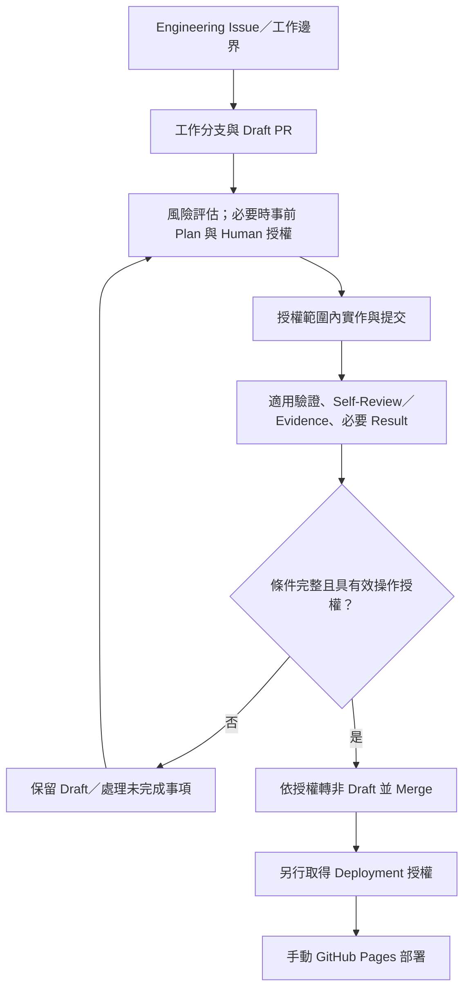

# myaiwouldbemine Copy Learning Hub

**A Multi-Disciplinary, Code-First, Evidence-Driven Learning Platform**

多學科、程式碼優先、證據導向的個人學習與知識管理平台。

## 1. Project Overview｜專案簡介

Copy Learning Hub 旨在將大學課程講義、技術文件、原始碼、數學公式及實作結果整理為可長期維護的線上學習教材。

主要學習流程：

**Source Materials → Deep Understanding → Code / Formula → Verification → Documentation → Web Publishing**

核心原則：

- **Code-First**：盡可能透過實際程式碼解釋理論。
- **Evidence-Driven**：重要結論必須具備可追溯的來源或驗證紀錄。
- **Page-by-Page Learning**：依原始教材頁碼逐頁深入學習。
- **Progressive Validation**：透過理解驗收與實作確認學習成果。
- **Reusable Knowledge**：將學習成果整理成可重複閱讀的文件。
- **Tool-Neutral Single-Builder**：每個工程 Issue／PR 由一位指定的 Claude Code 或 Codex Builder 負責，採 Self-Verification。

正式分工：ChatGPT＋Human 擁有 V2／V3 教材創作、推導、品質核准與整合定稿權；GitHub 保存已核准教材、版本與學習軌跡；MkDocs 提供閱讀、搜尋、導覽與展示。Engineering Builder 負責忠實匯入及工程驗證，不創作或改寫教材語意。

V2 Knowledge Consolidation 與 V3 Code-First Deep Dive：**製作時分開、定稿時合併、網站上依主題呈現**。

使用 **Learning Record** Issue 記錄學習目標、來源及後續進度，V2／V3 成果、驗收與歸檔參考可在 Comments 逐步補充，不必對應工程 PR。只有 Repository 變更才需要 **Engineering Task** 與相應工程流程。Issue 建立、CI PASS、PR Merge 或 Issue Closed 均不代表品質已核准、學習完成或完全掌握；歸檔完成與學習完成分開記錄。表單使用方式見 [Issue Forms 說明](docs/development/ISSUE_TEMPLATE_INSTALL.md)。

## 2. Learning Subjects｜學科分類

| Subject | Coverage |
|---|---|
| Operating Systems | NYCU OS, NachOS, Linux, Scheduling, Memory, File Systems |
| Machine Learning | Regression, Classification, Model Evaluation |
| Deep Learning | Neural Networks, Backpropagation, Optimization, PyTorch |
| Computer Vision | CNN, ResNet, Object Detection, Vision Transformers |
| Natural Language Processing | Tokenization, Embeddings, Attention, Transformers, LLM |

未來可新增其他學科，而不需要重新設計平台架構。

## 3. Technology Stack｜技術架構

| Component | Technology |
|---|---|
| Learning Content | Markdown |
| Static Website | MkDocs Material |
| Code Highlighting | Pygments / Markdown Extensions |
| Diagrams | Mermaid |
| Mathematics | MathJax |
| Version Control | Git / GitHub |
| CI/CD | GitHub Actions |
| Hosting | GitHub Pages |
| Future Interactive Labs | Streamlit / Python |
| Engineering Builder | Claude Code 或 Codex（單一 accountable Builder） |

目前採用 MkDocs Material 建立網站，未來可另行評估 Zensical 遷移。

## 4. Repository Structure｜專案結構

```text
myaiwouldbemine-Copy-Learning-Hub/
├── .github/
│   ├── PULL_REQUEST_TEMPLATE.md
│   └── workflows/
│       ├── docs-check.yml
│       └── pages.yml
├── docs/
│   ├── index.md
│   ├── subjects/
│   │   ├── operating-systems/
│   │   ├── machine-learning/
│   │   ├── deep-learning/
│   │   ├── computer-vision/
│   │   └── Natural-Language-Processing/
│   └── assets/
├── AGENTS.md
├── GOVERNANCE.md
├── INSTALL.md
├── mkdocs.yml
├── requirements.txt
└── README.md
```

部分 CI/CD 與學習內容仍屬規劃中，實際目錄以目前 Repository 為準。

## 5. Local Development｜本機開發

### Requirements

- Python 3.12+
- Git
- VS Code（建議）
- WSL Ubuntu（建議）

### Installation

```bash
git clone https://github.com/myaiwouldbemine/myaiwouldbemine-Copy-Learning-Hub.git
cd myaiwouldbemine-Copy-Learning-Hub

python3 -m venv .venv
source .venv/bin/activate

python -m pip install -r requirements.txt
```

### Local Preview

```bash
mkdocs serve
```

開啟：

http://127.0.0.1:8000/

### Build Validation

```bash
mkdocs build --strict
```

本機建置成功只代表網站能夠產生，不代表所有教材內容均已完成技術或教學驗收。

## 6. Learning Content Standards｜教材規範

每個完整的學習單元可包含：

- `README.md`：完整學習筆記。
- `EVIDENCE.md`：原始資料、程式碼與驗證證據。
- `TERMINOLOGY.md`：中英文專業術語。
- `CODE_WALKTHROUGH.md`：必要的程式碼分析。
- `FORMULAS.md`：必要的公式推導。
- `assets/`：圖片與教學圖表。

各學科可以採用專屬教學規範，但共用一致的文件與出版原則。

### Operating Systems

使用 **NYCU OS Learning Framework v3.1 OS Edition**。

重點包括：

- PDF 逐頁深入解說。
- NachOS / Linux 原始碼對照。
- MIPS Assembly。
- VS Code Code Walkthrough。
- Execution Flow / State Trace。
- 理解驗收與證據文件化。

## 7. GitHub PR Workflow & Agent Collaboration｜PR 工作流程與 Agent 協作

Copy Learning Hub 採用 **Pull Request First** 的開發模式。所有正式變更原則上均須經由 PR 合併至 `main`，確保修改過程可檢查、可驗證、可追溯。

### 7.1 Standard PR Workflow｜標準流程

Repository 工程變更採用 **Issue → Draft PR → Plan（必要時）→ Implementation → Result（必要時）→ Self-Review／CI → Authorized Merge**。L2／L3 的正式 Plan 必須先獨立提交並取得 Human 核准；L3 另需具體操作／範圍授權。Draft 不授予實作或 Merge 權限。



### 7.2 Agent Roles｜Agent 角色

採 **Tool-Neutral Single-Builder + Self-Verification**。每個工程 Issue／PR 在任一時點只有一位明確指定的 accountable Builder，可為 Claude Code 或 Codex，兩者適用完全相同的風險、驗證、Self-Review、Evidence 與授權規範。

Builder 負責工程實作、忠實匯入已核准教材、排版／網站相容性、CI、PR 與工程驗證。教材語意需要變更時標記 PENDING，由 ChatGPT／Human 決定。L1 起需可追溯的 Self-Review 與 Evidence，不強制交叉審查；Fresh-Context Challenge 依風險評估，Human 明確要求時必須執行。

交接須記錄前後 Builder、完整 Commit SHA、base／scope／risk、已完成／未完成事項、Evidence 與 Blockers。接手 Builder 重新確認目前 head 的 Self-Review、證據有效性及適用 Human 授權；更換工具不自動繼承舊審查或授權。

Self-Review／Bot Summary、原生 GitHub Review 與 Human Approval 分別記錄，不可互相冒充。

### 7.3 Branch & Commit｜分支與提交

所有日常修改須在獨立工作分支執行，不直接 Push 至 `main`。

建議 Branch Naming：

```text
feat/CLH-001-project-bootstrap
fix/CLH-002-navigation
docs/CLH-003-os-learning
ci/CLH-004-build-validation
```

每個 Commit 應說明清楚的修改目的，且避免將無關變更混在一起。

### 7.4 Pull Request Requirements｜PR 必要資訊

每個 PR 至少應包含：

| Field | Requirement |
|---|---|
| WHAT | 修改了什麼 |
| WHY | 為什麼需要修改 |
| TEST | 執行哪些測試及其結果 |
| Evidence | 原始碼、測試輸出或教材驗證依據 |
| Risk | 已知風險與影響 |
| Review | 審查結果及未解決問題 |

Repository 變更的 PR 應關聯工程 Issue。純學習紀錄不強制建立工程 PR。

### 7.5 Review & CI｜審查與自動化檢查

PR 應完成適用的測試及審查。

對 MkDocs 網站的基本驗證：

```bash
mkdocs build --strict
git diff --check
```

GitHub Actions 將負責執行設定好的自動化檢查。

網站 Build 成功並不代表教材的技術內容、程式碼解釋或證據鏈已完成驗收，兩者必須分別確認。

### 7.6 Agent Merge Authorization｜Agent 合併授權

Agent 只有在以下條件**全部符合**時，才可以執行 Merge：

1. 執行者具備權限且已獲明確 Merge 操作授權，PR 為非 Draft。
2. 必要實作、適用驗證／CI、目前 head 的 Self-Review 與 Evidence、必要 Result 均已完成；不存在缺失、失敗、待定或過期證據。
3. 沒有未解決的阻擋性 Review、評論或 Thread。
4. base／scope／risk 已確認，範圍與授權仍有效；有變動時完成重新評估及必要重新核准。
5. L2／L3 必要的 Plan 核准及 L3 具體操作／範圍授權完整。L1 不要求逐次 Human 內容核准，Merge 操作授權仍須獨立確認。

若任一條件未滿足，Agent 必須保留 PR 並回報，不得繞過 Branch Protection 或未通過的必要 CI。

### 7.7 High-Risk Changes｜高風險變更

以下操作需要使用者個別確認：

- 大量刪除或搬移資料。
- 修改治理控制、Repository 權限、安全設定或部署操作。
- 修改重要資料的來源或證據。
- 大規模重構。
- 可能造成不可逆結果的操作。

### 7.8 Governance References｜治理文件

- [GOVERNANCE.md](GOVERNANCE.md) — 正式治理政策。
- [AGENTS.md](AGENTS.md) — Claude Code / Codex 共用執行指令。
- [.github/PULL_REQUEST_TEMPLATE.md](.github/PULL_REQUEST_TEMPLATE.md) — PR 紀錄模板。

**Governance Principle：** PR 的目的在於保存清楚、可檢查、可追溯的學習與修改歷程，而非增加不必要的行政流程。

---

工程流程依 `GOVERNANCE.md`：一位指定 Builder 負責 Self-Review 與 Evidence；Plan 核准、實作、Ready、Merge 與 Deployment 分別依有效授權辦理。

## 8. Deployment｜網站部署

目前 GitHub Pages workflow 僅提供手動 `workflow_dispatch` 入口，部署工作限定 `main`。Merge 不會自動授權部署；每次執行仍需獨立 Deployment 授權，本流程不啟用 Auto-Merge。

預計網址：

https://myaiwouldbemine.github.io/myaiwouldbemine-Copy-Learning-Hub/

部署流程：

1. 依工程 Issue 建立 Feature Branch 與 Draft PR。
2. 完成必要 Plan／授權後，實作並執行適用驗證及 CI。
3. 完成目前 head 的 Self-Review／Evidence 與必要 Result。
4. 符合所有條件並取得操作授權後，依授權轉非 Draft 並合併至 `main`。
5. 另行取得 Deployment 授權後，從 `main` 手動觸發 Pages workflow。
6. GitHub Actions 建置並發布網站，再分別核對部署與視覺結果。

**目前部署狀態：尚未完成正式 GitHub Pages 上線驗收。**

## 9. Project Status｜目前進度

**CLH-001 — Project Bootstrap**

- [x] Git Repository 初始化。
- [x] Feature Branch 建立。
- [x] Python / MkDocs 環境安裝。
- [x] 基本網站建置驗證。
- [ ] Governance v1.1 合併至 main。
- [ ] GitHub Actions CI/CD 驗證。
- [ ] 首次 Pull Request 審查及合併。
- [ ] GitHub Pages 部署驗收。
- [ ] 匯入第一份完整 Code-First 學習教材。

以上進度依目前已提供的開發證據整理。

## 10. Roadmap｜未來發展

**Phase 1 — Documentation Portal**

建立穩定的多學科 Markdown 學習網站。

**Phase 2 — Learning Content Integration**

匯入 OS、ML、DL、CV、NLP 的正式學習教材。

**Phase 3 — Interactive Learning Labs**

建立 Streamlit / Python 互動模擬器與練習工具。

**Phase 4 — Personal Learning System**

加入學習進度、錯題複習、知識關聯及跨裝置同步。

---

**Project:** myaiwouldbemine Copy Learning Hub
**Repository:** https://github.com/myaiwouldbemine/myaiwouldbemine-Copy-Learning-Hub
**Development Policy:** Pull Request First
**Learning Philosophy:** Code-First · Evidence-Driven · Deep Understanding
