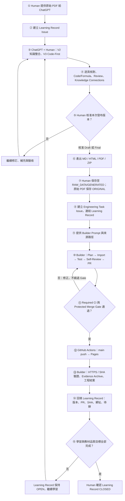
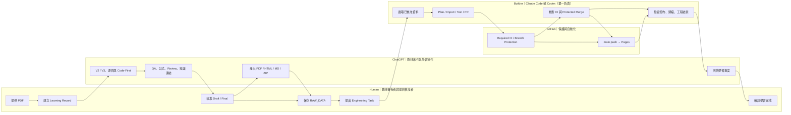
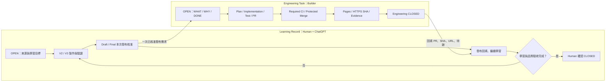
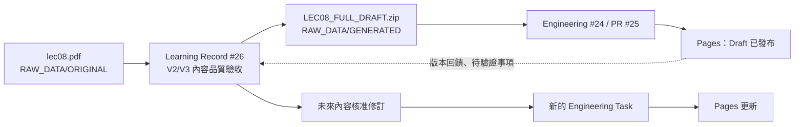

# Copy Learning Hub — 教材製作與發布流程圖

> **版本：** v1.0（2026-11-07）  
> **核心原則：** Learning-First · Engineering-Enabled · Governance-Minimal  
> **適用範圍：** Operating Systems、Machine Learning、Deep Learning、Computer Vision、NLP 與未來學科。  
> **文件定位：** 教材製作與發布作業說明；工程權限、合併與部署規則仍以 Repository 當前 `GOVERNANCE.md`、`AGENTS.md` 為準。

## 1. 工作流程總覽

教材的**學習與語義品質**由 Human + ChatGPT 負責；Repository 修改與網站發布由**唯一 accountable Builder**（Claude Code 或 Codex）負責。GitHub Actions 執行 CI 與 Pages 自動部署。



**重要：** Draft 的發布核准不等於教材語義已完全驗證；未完成的 PDF 圖示、原始碼與理解驗收必須保留 `PENDING`。Engineering Task `CLOSED` **不等於** Learning Record `COMPLETED`。

## 2. 四階段標準作業程序

| Phase | 步驟 | 主要工作 | 主要負責角色 | 紀錄／交付 |
|---|---|---|---|---|
| A · Learning | 1–2 | 提供 PDF、建立 Learning Record | Human + ChatGPT | Learning Issue |
| A · Learning | 3–5 | V2/V3、來源核對、理解驗收、內容核准 | ChatGPT 製作；Human 核准 | V2/V3、Evidence、QA 狀態 |
| A · Content | 6 | 產出 Markdown、HTML、PDF、ZIP 等適用格式 | ChatGPT + Human | 有版本識別的教材包 |
| B · Local | 7 | 原始 PDF 與產出分別存入 `ORIGINAL/`、`GENERATED/` | Human | RAW_DATA、SHA-256、授權註記 |
| C · Engineering | 8–9 | 開 Engineering Task、提供 Builder Prompt | Human + ChatGPT | Engineering Issue，連結 Learning Record |
| C · Engineering | 10–11 | Plan、匯入、測試、自審、PR、CI、Protected Merge | Builder | PR、測試與工程紀錄 |
| C · Publishing | 12–13 | main push Pages、HTTPS SHA 核對、歸檔、工程結案 | GitHub Actions + Builder | Pages URL、Merge SHA、Evidence Archive |
| D · Feedback | 14–15 | 回填學習 Issue、補正或最終學習結案 | Human + ChatGPT | 學習狀態與下次修訂清單 |

### Phase A：Learning & Content Creation

- **Learning Record 應在首次提供 PDF 後、正式製作教材前建立。** 已先發布的舊教材可以補建，不必重做工程。
- V2：逐頁概念、圖表、公式、Review、術語與知識整合。
- V3：真實程式碼優先，包含來源版本、路徑、行號、Call Flow、Runtime 與驗收；未驗證不得標示 `VERIFIED SOURCE`。
- Knowledge Connections 必須具有實質學習價值，不為了連結而連結；每次工程匯入保留 `RELEARNING_SUPPLEMENTS/ISSUE-<number>/` 的補充清單，沒有適用連結時寫「無」。
- Human 可以核准 **Draft** 試發布；這不表示學習完成。

### Phase B：Local RAW_DATA

```text
RAW_DATA/
├── README.md
└── operating-systems/
    └── LEC08/
        ├── ORIGINAL/
        │   └── lec08.pdf
        └── GENERATED/
            └── LEC08_FULL_DRAFT.zip
```

- `ORIGINAL/`：原始講義與來源，原則上唯讀、不覆蓋。
- `GENERATED/`：ChatGPT + Human 產出，保留版本，包含 PDF、HTML、MD、ZIP。
- `RAW_DATA/` 原則上只存本機，原始 PDF 與 ZIP 不應被意外 Commit 或公開；以 `.gitignore` 核對排除規則。
- 記錄 SHA-256、來源及授權；因 Git 不備份被忽略的資料，需另外備份。
- Builder 唯讀取用 RAW_DATA，僅將經核准可發布的內容匯入 `docs/`。

### Phase C：Engineering Publication

- Engineering Task 必須清楚列出 WHAT、WHY、Acceptance Criteria、Boundary，以及對應 Learning Record。
- Builder 依現行治理執行 Plan（適用時）、實作、測試、自審、PR、Required CI、Protected Merge。
- `main` 合併後自動觸發 GitHub Pages；Builder 核對 HTTPS 網站與 `deployment-sha.txt` 的完整 SHA，完成 Evidence Archive、遠端讀回與工程 Issue 結案。
- 不直接 push `main`、不繞過保護、不擅自改寫教材語義或公開原始資料。

### Phase D：Learning Feedback & Completion

- 將發布網址、PR、Merge SHA、版本及待驗證事項回填 Learning Record。
- 學習未完成就保持 Learning Record `OPEN`；需要更新網站時，再開下一個 Engineering Task。
- 只有 Human 確認學習目標及教材品質驗收完成，才關閉 Learning Record。

## 3. 角色扮演與交接流程（Swimlane）



此圖表示**職責交接**，不是要求 Human 逐次批准 Builder 的每個工程操作；工程流程按當前 Governance 自主執行。

## 4. 角色責任矩陣

| 工作 | Human | ChatGPT | Builder（Claude Code / Codex） | GitHub / Actions |
|---|---|---|---|---|
| 提供原始 PDF、確認來源與授權 | **負責** | 協助分析 | 不得擅自公開 | — |
| Learning Record 與學習目標 | **決定** | 協助建立／維護 | — | 保存 Issue |
| V2／V3 教材製作 | 語義核准 | **主要製作** | 忠實匯入、不改寫語義 | — |
| PDF 逐頁、NachOS Code、Review 驗收 | **最終確認** | 教學、推導與查證 | — | — |
| PDF／HTML／MD／ZIP 產出 | 確認發布範圍 | **製作** | 按核准內容匯入 | — |
| RAW_DATA 與備份 | **保管** | 協助整理 | 唯讀取用 | 不公開原始檔 |
| Engineering Task 與 Builder Prompt | 定義需求／邊界 | 協助撰寫 | 接收執行 | 保存 Issue |
| Plan、測試、自審、PR、Protected Merge | 不需逐步人工核准；保有停止權 | — | **負責** | CI、保護檢查 |
| Pages 自動部署 | — | — | **驗證** | **執行** |
| Evidence Archive、工程結案 | — | — | **負責** | 保存紀錄 |
| 學習完成與 Learning Record 結案 | **決定** | 協助評估 | 不代為判定學習完成 | 保存紀錄 |

## 5. 兩種 Issue 的生命週期



**一對多關係：** 一個 Learning Record 可以關聯多個 Engineering Task（Draft v1、修訂 v2、Final 等）。工程合併、Pages 成功或 Engineering Issue 關閉，**都不能直接推論教材已通過學習驗收**。

## 6. LEC08 實際案例



- [Learning Record #26 — LEC08 V2/V3 學習與品質驗收](https://github.com/myaiwouldbemine/myaiwouldbemine-Copy-Learning-Hub/issues/26)
- [Engineering Task #24 — LEC08 Draft Web 試發布](https://github.com/myaiwouldbemine/myaiwouldbemine-Copy-Learning-Hub/issues/24)
- [PR #25 — Draft 教材匯入](https://github.com/myaiwouldbemine/myaiwouldbemine-Copy-Learning-Hub/pull/25)
- [LEC08 Draft 網站](https://myaiwouldbemine.github.io/myaiwouldbemine-Copy-Learning-Hub/subjects/operating-systems/lec08/)
- [Engineering Task #27 — README 流程文件化](https://github.com/myaiwouldbemine/myaiwouldbemine-Copy-Learning-Hub/issues/27)

## 7. 目錄與證據責任

| 路徑 | 角色與用途 |
|---|---|
| `RAW_DATA/<subject>/<unit>/ORIGINAL/` | 本機原始 PDF 等來源；唯讀、不公開 |
| `RAW_DATA/<subject>/<unit>/GENERATED/` | 本機多格式產出與版本化 ZIP；不自動公開 |
| `docs/subjects/...` | Builder 忠實匯入的網站可發布 Markdown／素材 |
| `RELEARNING_SUPPLEMENTS/ISSUE-<number>/` | 工程 Issue 對應的再學習補充清單；無連結註明「無」 |
| `records/ISSUE-<number>/` | 工程 Plan、Result、測試、PR 與部署證據 |
| `README.md` | Repository 概覽與本流程入口 |
| `RAW_DATA/README.md` | 本機來源資料保管細則，連回本流程 |

## 8. 驗收清單

- [ ] Learning Record 已建立，來源、目標、驗收狀態明確。
- [ ] 原始 PDF 已保存在 `ORIGINAL/`，確認授權、SHA-256 與本機備份。
- [ ] V2/V3 已製作，來源與推導可追溯；未驗證事項標為 `PENDING`。
- [ ] Human 已核准本次發布範圍（Draft 或 Final），不是默認學習完成。
- [ ] MD／HTML／PDF／ZIP 等適用產出已存入 `GENERATED/`，版本可辨識。
- [ ] Engineering Task 連結 Learning Record，WHAT／WHY／DONE／Boundary 清楚。
- [ ] Builder 未更動原始資料或擅自改寫教材語義。
- [ ] Required CI、Protected Merge、Pages、HTTPS SHA 與 Evidence Archive 符合現行 Governance。
- [ ] 發布資訊已回填 Learning Record；未完成學習繼續保持 OPEN。
- [ ] 僅在 Human 確認學習目標達成後，才關閉 Learning Record。

---

**維護原則：** 此文件說明標準流程；如與 Repository 現行治理或實際自動化有衝突，應先核對並修訂文件，不可為符合圖示而放寬安全 Gate。
