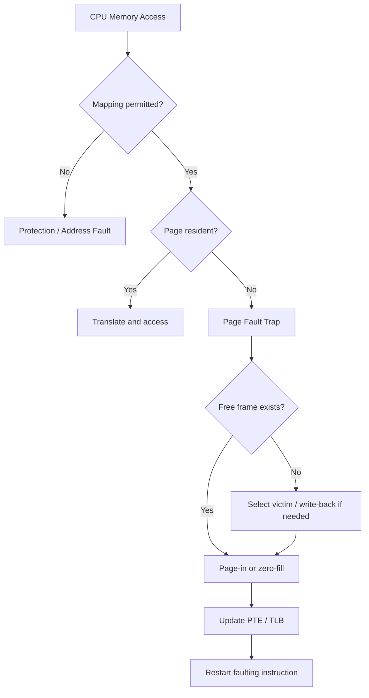
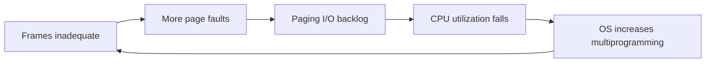
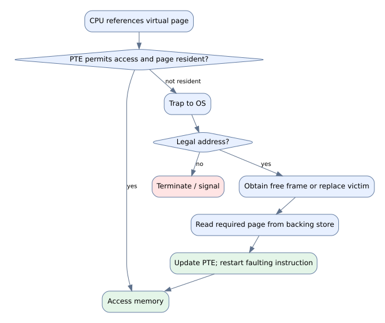
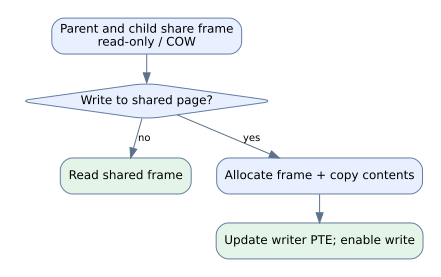
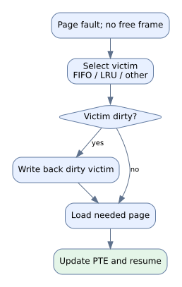
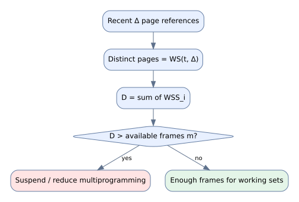
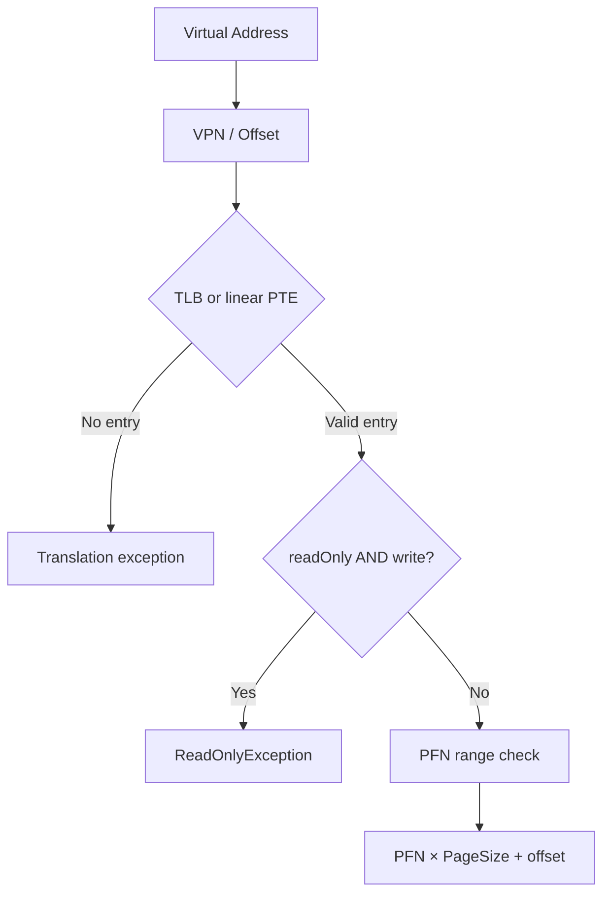

# NYCU OS LEC09 — Virtual Memory Management｜Canonical Learning Markdown v4.1（候選精修版）

!!! danger "DRAFT — Under Learning Review"
    此頁為 **預覽草稿**，尚未通過 Human 教材語義核准，不是正式 Canonical 教材。原始 PDF 未公開。Learning Record #41 仍為 OPEN。


> **CANDIDATE / HUMAN QA PENDING**。整合既有 v4.0 V2/V3 教材，避免平行維護。原始 PDF 僅供本機證據核對，未包含於本教材包。來源圖片已選頁視覺核對，其他頁面的圖像 QA 仍待人工逐頁檢查。

## 1. 學習目標與來源邊界

- 原始 PDF：LEC09，**55 頁**；以 PDF 頁序標示 p.N。
- NachOS baseline：[5ricarthuang/nycu-os](https://github.com/ericarthuang/nycu-os) 的 `nachos/NachOS/code`；此教材核對 GitHub baseline，**沒有執行現行 HW01 工作樹**。
- Learning Record：[# 41](https://github.com/myaiwouldbemine/myaiwouldbemine-Copy-Learning-Hub/issues/41)。
- 驗證層次：`PDF TEXT CHECKED`、`SELECTED FIGURE VISUALLY CHECKED`、`CODE VERIFIED (GitHub)`、`DERIVED`、`RUNTIME NOT RUN`；不要把不同層次混稱 PASS。

## 2. 原始 PDF 逐頁來源核對（55/55 文字層）

以下每頁皆以原始 PDF 文字層重新核對。**圖像或公式無文字層時，不會推測圖中的箭頭或數值**；特定重要圖已以原始投影片影像人工查看後重繪。表中未標示 VISUALLY CHECKED 的圖像仍屬待驗證。

| PDF 頁 | 核對到的原始文字／公式線索 | 本次核對狀態 |
|---|---|---|
| 01 | Department of Computer Science Operating System Lecture 09: Virtual Memory Management Shuo-H… | TEXT CHECKED；FIGURE QA PENDING |
| 02 | Course Schedule W Date Lecture Note Homework 1 Sept. 9 Lec00: Couse Overview & Historical Pr… | TEXT CHECKED；FIGURE QA PENDING |
| 03 | Overview • Background • Demand Paging • Process Creation • Page Replacement • Allocation of … | TEXT CHECKED；FIGURE QA PENDING |
| 04 | Background • Why we don’t want to run a program that is entirely in memory…. • Many code for… | TEXT CHECKED；FIGURE QA PENDING |
| 05 | Background • Virtual memory – separation of user logical memory from physical memory • To ru… | TEXT CHECKED；FIGURE QA PENDING |
| 06 | Virtual Memory vs. Physical Memory 6 | TEXT CHECKED；FIGURE QA PENDING |
| 07 | VA PA Valid Bit 7 | TEXT CHECKED；FIGURE QA PENDING |
| 08 | Demand Paging • A page rather than the whole process is brought into memory only when it is … | TEXT CHECKED；FIGURE QA PENDING |
| 09 | Demand Paging • A swapper (midterm scheduler) manipulates the entire process, whereas a page… | TEXT CHECKED；FIGURE QA PENDING |
| 10 | Demand Paging 10 | TEXT CHECKED；FIGURE QA PENDING |
| 11 | 文字層無足夠內容，需查圖 | TEXT CHECKED；FIGURE QA PENDING |
| 12 | Page Fault • First reference to a page will trap to OS • -> page-fault trap • OS looks at th… | TEXT CHECKED；FIGURE QA PENDING |
| 13 | Page Fault Handling Steps 13 | TEXT CHECKED；FIGURE QA PENDING |
| 14 | Page Replacement • If there is no free frame when a page fault occurs • Swap a frame to back… | TEXT CHECKED；FIGURE QA PENDING |
| 15 | EAT=(1-p)×ma+p×pft；ma=200ns，pft=8ms，EAT=200+7,999,800p ns | TEXT / FORMULA CHECKED；視覺註記另列 |
| 16 | Demand Paging Performance (Con’t) • Programs tend to have locality of reference • Locality m… | TEXT CHECKED；FIGURE QA PENDING |
| 17 | Process & Virtual Memory • Demand Paging: only bring in the page containing the first instru… | TEXT CHECKED；FIGURE QA PENDING |
| 18 | Copy-on-Write • Allow both the parent and the child process to share the same frames in memo… | TEXT CHECKED；FIGURE QA PENDING |
| 19 | When a child process is forked 19 | TEXT CHECKED；FIGURE QA PENDING |
| 20 | After a page is modified 20 | TEXT CHECKED；FIGURE QA PENDING |
| 21 | Memory-Mapped Files • Approach: • MMF allows file I/O to be treated as routine memory access… | TEXT CHECKED；FIGURE QA PENDING |
| 22 | Memory-Mapped File Example 22 | TEXT CHECKED；FIGURE QA PENDING |
| 23 | 23 | TEXT CHECKED；FIGURE QA PENDING |
| 24 | Review Slides ( I ) • Virtual memory? Physical Memory? • Demand paging? • Page table support… | TEXT CHECKED；FIGURE QA PENDING |
| 25 | Page Replacement Concept • When a page fault occurs with no free frame • swap out a process,… | TEXT CHECKED；FIGURE QA PENDING |
| 26 | Page Replacement (Page Fault) Steps • Find the location of the desired page on disk • Find a… | TEXT CHECKED；FIGURE QA PENDING |
| 27 | Page Replacement (Page Fault) Example 27 | TEXT CHECKED；FIGURE QA PENDING |
| 28 | Page Replacement Algorithms • Goal: lowest page-fault rate • Evaluation: running against a s… | TEXT CHECKED；FIGURE QA PENDING |
| 29 | Replacement Algorithms • FIFO algorithm • Optimal algorithm • LRU algorithm • Counting algor… | TEXT CHECKED；FIGURE QA PENDING |
| 30 | FIFO reference string 1,2,3,4,1,2,5,1,2,3,4,5；3 frames = 9 faults | TEXT / FORMULA CHECKED；視覺註記另列 |
| 31 | FIFO Illustrating Belady’s Anomaly • Does more allocated frames guarantee less page fault? •… | TEXT CHECKED；FIGURE QA PENDING |
| 32 | 圖像核對：FIFO fault count 隨 frames 3→4 由 9→10，Belady anomaly | TEXT + SELECTED FIGURE VISUALLY CHECKED |
| 33 | Optimal；4 frames = 6 faults（依原投影片） | TEXT / FORMULA CHECKED；視覺註記另列 |
| 34 | LRU Algorithm (Least Recently Used) • An approximation of optimal algorithm: • looking backw… | TEXT CHECKED；FIGURE QA PENDING |
| 35 | LRU Algorithm Implementations • Counter implementation • page referenced: time stamp is copi… | TEXT CHECKED；FIGURE QA PENDING |
| 36 | Stack Algorithm • A property of algorithms • Stack algorithm: the set of pages in memory for… | TEXT CHECKED；FIGURE QA PENDING |
| 37 | LRU approximation algorithms • Few systems provide sufficient hardware support for the LRU p… | TEXT CHECKED；FIGURE QA PENDING |
| 38 | Counting Algorithms • LFU Algorithm (least frequently used) • keep a counter for each page •… | TEXT CHECKED；FIGURE QA PENDING |
| 39 | Introduction • Each process needs minimum number of frames • E.g.: IBM 370 – 6 pages to hand… | TEXT CHECKED；FIGURE QA PENDING |
| 40 | Frame Allocation • Fixed allocation • Equal allocation – 100 frames, 5 processes -> 20 frame… | TEXT CHECKED；FIGURE QA PENDING |
| 41 | Frame Allocation • Local allocation: each process select from its own set of allocated frame… | TEXT CHECKED；FIGURE QA PENDING |
| 42 | Review Slides ( II ) • Page replacement steps? • Place replacement algorithm goal? • Dirty b… | TEXT CHECKED；FIGURE QA PENDING |
| 43 | Definition of Thrashing • If a process does not have “enough” frames • the process does not … | TEXT CHECKED；FIGURE QA PENDING |
| 44 | Thrashing • Performance problem caused by thrashing (Assume global replacement is used) • pr… | TEXT CHECKED；FIGURE QA PENDING |
| 45 | Working-Set Model • Locality: a set of pages that are actively used together • Locality mode… | TEXT CHECKED；FIGURE QA PENDING |
| 46 | 圖像核對：Δ=10，WS(t1)={1,2,5,6,7}、WS(t2)={3,4} | TEXT + SELECTED FIGURE VISUALLY CHECKED |
| 47 | D=ΣWSS_i；D>m 時應降低多工程度 | TEXT / FORMULA CHECKED；視覺註記另列 |
| 48 | Page Fault Frequency 上下界；高於上界加 frames，低於下界可回收 frames | TEXT / FORMULA CHECKED；視覺註記另列 |
| 49 | Page Fault Frequency Scheme 49 | TEXT CHECKED；FIGURE QA PENDING |
| 50 | Working Sets and Page Fault Rates Peak of new locality • Memory has locality property • When… | TEXT CHECKED；FIGURE QA PENDING |
| 51 | Review Slides ( III ) • Thrashing definition? • Process locality? • When will thrashing happ… | TEXT CHECKED；FIGURE QA PENDING |
| 52 | Reading Material & HW • Chap 9 • Problems • 9.3, 9.4, 9.6, 9.8, 9.9, 9.11, 9.14, 9.17, 9.19,… | TEXT CHECKED；FIGURE QA PENDING |
| 53 | Backup 53 | TEXT CHECKED；FIGURE QA PENDING |
| 54 | Windows NT • Uses demand paging with clustering. Clustering brings in pages surrounding the … | TEXT CHECKED；FIGURE QA PENDING |
| 55 | Q&A Thank you for your attention | TEXT CHECKED；FIGURE QA PENDING |

## 3. 概念整合與逐頁教學（V2 方法融入）


> **學習用途的完整主題教材／55 頁對照索引。** 原講義 55 頁已檢閱文字層；部分圖像頁仍須逐頁視覺 QA。原講義不在公開教材包內。來源為使用者提供的 `lec09.pdf`、NYCU_OS LR05 README/EVIDENCE 與 GitHub NachOS baseline。學習完成與 Human 語義核准尚未宣稱 PASS。

### WHAT / WHY / Learning Outcomes

LEC08 告訴我們 **如何把 Virtual Address 翻譯成 Physical Address**；LEC09 則進一步回答：當 Virtual Page **暫時不在 RAM** 時怎麼辦？當 Physical Frames 不夠時又如何選擇 victim？

學完應能：區分合法位址與頁面是否駐留；畫出可恢復的 Page Fault Flow；手算 FIFO／Optimal／LRU；推導 Page Fault EAT；說明 Working Set／Thrashing；辨認 Copy-on-Write 與 Memory-Mapped File 的目的，並指出基礎 NachOS 與完整 demand-paging kernel 的差距。

### 原講義逐頁索引（55/55）

此表依 PDF 真實頁序整理；`FIGURE QA PENDING` 不代表忽略該頁，而是**不能從文字層推定圖上的全部數值／箭頭**。

| PDF Page | 核心內容 | 證據狀態 |
|---|---|---|
| 01 | 封面：Virtual Memory Management | PDF TEXT CHECKED (visual not exhaustive) |
| 02 | 課程時程：Lec09 與 HW01 | PDF TEXT CHECKED (visual not exhaustive) |
| 03 | 章節地圖：Demand Paging / Replacement / Allocation / Thrashing | PDF TEXT CHECKED (visual not exhaustive) |
| 04 | 為何不希望整個程式常駐記憶體 | PDF TEXT CHECKED (visual not exhaustive) |
| 05 | Virtual Memory 的用途與較大位址空間 | PDF TEXT CHECKED (visual not exhaustive) |
| 06 | Virtual vs Physical Memory 對照圖（視覺細節待核） | FIGURE QA PENDING |
| 07 | Page Table valid-bit 示意（圖中細節待核） | FIGURE QA PENDING |
| 08 | Demand Paging：按需載入、非法與缺頁的區別 | PDF TEXT CHECKED (visual not exhaustive) |
| 09 | Pager／Swapper、PTE 與 backing store 支援 | PDF TEXT CHECKED (visual not exhaustive) |
| 10 | Demand Paging 示意圖（視覺細節待核） | FIGURE QA PENDING |
| 11 | 圖像頁：本次 PDF 文字擷取未取得可讀文字，待視覺核對 | PDF TEXT CHECKED (visual not exhaustive) |
| 12 | Page Fault：合法性確認、frame、page-in、restart | PDF TEXT CHECKED (visual not exhaustive) |
| 13 | Page Fault Handling Steps 流程圖（視覺細節待核） | FIGURE QA PENDING |
| 14 | 無 free frame 時的 Page Replacement | PDF TEXT CHECKED (visual not exhaustive) |
| 15 | Demand Paging EAT 公式與 8ms 範例 | PDF TEXT CHECKED (visual not exhaustive) |
| 16 | Locality 與 page-fault penalty 成本來源 | PDF TEXT CHECKED (visual not exhaustive) |
| 17 | Process creation、COW、Memory-Mapped File | PDF TEXT CHECKED (visual not exhaustive) |
| 18 | Copy-on-Write 機制與 zeroed frame | PDF TEXT CHECKED (visual not exhaustive) |
| 19 | Fork 前後共享 frames 圖（視覺待核） | FIGURE QA PENDING |
| 20 | 寫入後 COW 分離圖（視覺待核） | FIGURE QA PENDING |
| 21 | Memory-Mapped File 的 I/O 語義 | PDF TEXT CHECKED (visual not exhaustive) |
| 22 | Memory-Mapped File Example（視覺待核） | FIGURE QA PENDING |
| 23 | 圖像／轉場頁（文字層無標題，待核） | FIGURE QA PENDING |
| 24 | Review Slides (I)：Virtual Memory／Demand Paging／COW／MMF | PDF TEXT CHECKED (visual not exhaustive) |
| 25 | Replacement、dirty bit、frame table | PDF TEXT CHECKED (visual not exhaustive) |
| 26 | Page Replacement 的六步驟與重新執行 | PDF TEXT CHECKED (visual not exhaustive) |
| 27 | Replacement Page Fault Example（視覺待核） | FIGURE QA PENDING |
| 28 | Reference string 與 faults 計算方法 | PDF TEXT CHECKED (visual not exhaustive) |
| 29 | FIFO／Optimal／LRU／LFU／MFU 概覽 | PDF TEXT CHECKED (visual not exhaustive) |
| 30 | FIFO：3 frames、9 faults（圖已抽查） | PDF TEXT CHECKED (visual not exhaustive) |
| 31 | FIFO：4 frames、10 faults，Belady anomaly（圖已抽查） | PDF TEXT CHECKED (visual not exhaustive) |
| 32 | Belady anomaly 補充圖（視覺待核） | FIGURE QA PENDING |
| 33 | Optimal：未來最遠使用；4 frames、6 faults | PDF TEXT CHECKED (visual not exhaustive) |
| 34 | LRU：根據最近使用時間 | PDF TEXT CHECKED (visual not exhaustive) |
| 35 | LRU counter 與 stack 實作 | PDF TEXT CHECKED (visual not exhaustive) |
| 36 | Stack algorithm 與沒有 Belady anomaly | PDF TEXT CHECKED (visual not exhaustive) |
| 37 | Approximation：reference bits／second chance | PDF TEXT CHECKED (visual not exhaustive) |
| 38 | LFU 與 MFU 計數策略 | PDF TEXT CHECKED (visual not exhaustive) |
| 39 | 每 Process 最少 frame 數的條件 | PDF TEXT CHECKED (visual not exhaustive) |
| 40 | Fixed、Equal、Proportional、Priority Allocation | PDF TEXT CHECKED (visual not exhaustive) |
| 41 | Local vs Global Replacement | PDF TEXT CHECKED (visual not exhaustive) |
| 42 | Review Slides (II)：Replacement／Allocation | PDF TEXT CHECKED (visual not exhaustive) |
| 43 | Thrashing 定義 | PDF TEXT CHECKED (visual not exhaustive) |
| 44 | Thrashing 與 multiprogramming 惡性循環 | PDF TEXT CHECKED (visual not exhaustive) |
| 45 | Locality／Working Set 概念 | PDF TEXT CHECKED (visual not exhaustive) |
| 46 | Working Set 圖例（視覺待核） | FIGURE QA PENDING |
| 47 | ΣWSS 與可用 frames 的判斷 | PDF TEXT CHECKED (visual not exhaustive) |
| 48 | Page Fault Frequency 上下界 | PDF TEXT CHECKED (visual not exhaustive) |
| 49 | PFF 曲線／圖（視覺待核） | FIGURE QA PENDING |
| 50 | Working Sets 與 Page Fault Rate 變化 | PDF TEXT CHECKED (visual not exhaustive) |
| 51 | Review Slides (III)：Thrashing／Locality | PDF TEXT CHECKED (visual not exhaustive) |
| 52 | 課外閱讀與習題 | PDF TEXT CHECKED (visual not exhaustive) |
| 53 | Backup section | PDF TEXT CHECKED (visual not exhaustive) |
| 54 | Windows NT demand paging／working-set 機制（課堂歷史例） | PDF TEXT CHECKED (visual not exhaustive) |
| 55 | Q&A | PDF TEXT CHECKED (visual not exhaustive) |

### Virtual Memory 與 Demand Paging（pp.4–13） { #lec09-5669727475616c204d656d6f72792082072044656d616e6420506167696e-39 }

#### 3.1 Virtual Address Space 大於 Physical Memory

Virtual Memory 將**每個 Process 看見的邏輯位址空間**與實體 RAM 容量分開。程式可以擁有比 RAM 大的有效 Virtual Address Space，但這**不代表它同時存放於實體記憶體**。需要分清楚：`VA mapped?`、`access permitted?` 與 `page resident?` 是不同維度。

#### 3.2 按需載入

Demand Paging 不要求在 Process 開始時把所有 pages 放入 RAM。第一次存取一個合法但尚未駐留的 page 時，可以觸發可恢復的 Page Fault。若 VA 本身非法、越界或存取權限不符，必須拒絕，不可當成合法缺頁隨意配置。



**重要：** TLB miss 只是快取中沒有轉譯，頁面可能依然在 RAM；真正 disk page-in 取決於 backing-store / residency state。上圖為**一般 OS 設計模型**，不代表 GitHub 基礎 NachOS 已實作完整 handler。

### EAT：缺頁率與速度（pp.15–16）

若 `p` 是 Memory Access 的 Page Fault 機率，`ma` 是一般 memory access 的時間，`pft` 表示**含該次 Fault Access 完整成本**，則：

`EAT = (1-p) × ma + p × pft`

講義 p.15：`ma=200 ns`，`pft=8 ms=8,000,000 ns`：

`EAT = 200 + 7,999,800p ns`。

假設 `p=0.001`，得到 `EAT=8,199.8 ns`（約為 200 ns 的 41 倍）。如果題目把 penalty 當額外成本，則應寫 `EAT = ma + p × extra_penalty`，不可把不同定義混用。注意換單位：1 ms = 1,000,000 ns。

### Process Creation / COW / Memory-Mapped File（pp.17–23）

**Copy-on-Write**：Parent/Child 可以起初共享同一個 Physical Frame，通常限制寫入；當一方寫入，需要分配新 frame、複製原資料、修改該方 PTE，並保護另一方映射。並非每次 fork 立即複製所有 pages。一般由 page protection fault + OS COW bookkeeping 處理，不能與普通「非法寫入」混為一談。

**Memory-Mapped File**：透過 file-backed mappings 將檔案區塊呈現在地址空間，程式以 load/store 存取。初次存取、dirty page write-back、flush/sync 的時機依 OS 與映射模式而異；**不是完全沒有 I/O，也不代表每次 store 立即持久化**。

### Page Replacement：從沒有 Frame 到選擇 Victim（pp.25–38） { #lec09-50616765205265706c6163656d656e74ff1a5f9e6c926709204672616d65-47 }

在合法缺頁且沒有 free frame 時：找來源位置 → 依演算法選 victim frame → 必要時寫回 dirty page → 更新舊 mapping → 將新 page 放入該 frame → 更新 PTE/TLB → **restart**。Replacement 的目標是降低 page faults（也應考慮 dirty writes、局部性與實作成本）。

#### 6.1 FIFO / Optimal / LRU

- **FIFO**：移除最早進入 RAM 的 page；Hit 不改變 FIFO 排隊順序。
- **Optimal**：選擇未來最久才會再次使用的 page；作為理論最低 fault 數比較基準。
- **LRU**：淘汰「過去最長時間沒有被存取」的 page；Hit 會更新 recency。

講義 pp.30–31：Reference String `1,2,3,4,1,2,5,1,2,3,4,5`。

| Frames | FIFO Page Faults | 備註 |
|---|---:|---|
| 3 | 9 | p.30 圖已抽查 |
| 4 | 10 | p.31 圖已抽查，Belady's anomaly |

因為 FIFO 不具有 Stack Property，增加 frames 反而可能增加 faults。Optimal 與真正的 LRU 是 stack algorithms，不會出現這類 frame-inclusion 的 Belady anomaly。

#### 6.2 可逐步重算的短例

Reference String `1,2,3,1,4,2,5`，3 frames，FIFO：

| Step | Ref | Frames（oldest→newest） | Hit/Fault | 淘汰 |
|---|---|---|---|---|
| 1 | 1 | 1 | Fault | — |
| 2 | 2 | 1,2 | Fault | — |
| 3 | 3 | 1,2,3 | Fault | — |
| 4 | 1 | 1,2,3 | Hit | — |
| 5 | 4 | 2,3,4 | Fault | 1 |
| 6 | 2 | 2,3,4 | Hit | — |
| 7 | 5 | 3,4,5 | Fault | 2 |

總 Faults=5。這個例子強化 **FIFO Hit 不更新順序**；若誤把它當成 LRU，Step 5 的 victim 就可能算錯。

### Frame Allocation 與 Replacement Scope（pp.39–42）

**Allocation Policy：** Equal（平均 frame 配額）、Proportional（按 address-space size）、Priority（按重要程度）。**Replacement Scope：** Local（只從本 Process 選 victim）與 Global（可能選其他 Process frame）。「配多少」不等於「從誰換」。固定配額也不等於只能用 local victim，具體取決於政策組合。

### Thrashing、Locality、Working Set、PFF（pp.43–51）

**Thrashing**：Process 缺少維持活躍 locality 所需 frames，造成大量 Page Fault / Paging I/O，CPU 時間反而被等待與 paging 消耗。



**Working Set**：對 Process i，`WS_i(t, Δ)` 表示最近 Δ 次記憶體參照中實際用到的不同 pages，`WSS_i=|WS_i|`。`D=Σ_i WSS_i` 是所有 Process 同時需要的 frame 總量估計；若 `D > m`（可用 frames），代表 frames 不足、thrashing 風險高，而不是數學上必然每個 Process 都立刻 thrash。

例：最近四次 Page References `4,1,5,2`，Working Set `{1,2,4,5}`，WSS=4。

**PFF (Page Fault Frequency)**：直接監控每 Process 的 fault rate；高於上界可增加 frames，低於下界可回收 frames。若全系統 frames 不足，應降低 multiprogramming、suspend／swap-out 適當 Process，而非無限給每人更多 frames。

### 三組 Slide Review 完整導讀

#### Review (I), p.24 — Virtual Memory / Demand Paging / COW / MMF

1. Virtual vs physical：VA 是邏輯位址抽象，PA 是 RAM 位置；映射由硬體＋OS 狀態決定。
2. Demand paging：合法但未駐留的 page 在首次需要時載入，而不是 Load 時載入所有 pages。
3. Page table support：可用／resident／protected 映射及 backing-store 資訊；OS 需區分非法地址與暫缺頁。
4. Page fault flow：判定合法 → free frame 或 victim → page-in/zero-fill → 更新 mapping → restart。
5. Replacement：Frames 不足時選 victim，目標較少 faults 且兼顧 I/O 成本。
6. COW：fork 後延遲複製，只在寫入需要獨立內容時複製。
7. MMF：建立 file-backed page mapping，並不是無 I/O。

#### Review (II), p.42 — Replacement / Allocation

1. 步驟：find page → free/victim → conditional write-back → page-in → PTE/TLB → restart。
2. 目標：降低 fault rate 與相關換頁成本。
3. Dirty bit：辨識已修改頁，決定是否需寫回 backing store。
4. Belady anomaly：FIFO 可能 3→4 frames 反而 9→10 faults（p.30–31）。
5. FIFO / Optimal / LRU：分別依 load time / next future use / last past use。
6. Fixed/priority allocation：配額不變／依優先權調整；與 replacement scope 不同。
7. Global/local：victim 是否可跨 Process 選取。

#### Review (III), p.51 — Thrashing / Locality

1. Thrashing：大量時間花在 paging I/O，壓低有效 CPU 執行。
2. Locality：一段期間重複使用相對集中的 pages。
3. 發生條件：活躍頁需求顯著超過可用 frames；用 Working Set、PFF、減少多程式程度處理。

### Knowledge Connections — 内容層的關係，不是標籤連線

- **LEC08 VPN/offset → LEC09 Demand Paging**：只有明白 `Machine::Translate()` 如何查 PTE，才能區分「沒有 translation」是非法位址、TLB miss 或合法未駐留。先回訪 [LEC08 §4 V3-A 位址轉換 Code Trace](../lec08/index.md#lec08-56332d41ff1a5f9e865b64ec4f4d574052305be69ad44f4d5740ff087070-25) 的 Code Trace，再回到本章 Page Fault Flow。
- **HW01 eager loader → 理想 demand loader**：比較在 `Load()` 就分配 Frames 與在 fault 時分配 Frames 的成本和生命週期；目前 HW01 證據不等於已實作 Replacement。
- **Page Fault → File System**：file-backed page 的 read/write 與 FS02 的 OpenFile/ReadAt 等 I/O 機制在概念上相關，但標準 NachOS 尚無通用 mmap；必須標註差異。

實際再學習事項見 `LEC09_RELEARNING_SUPPLEMENTS.md`。此節的 Obsidian WikiLink 為專用 Vault 版示例；MkDocs 版應以相對 Markdown 連結呈現。

### 分階段理解驗收（附答案要點）

1. TLB Miss 是否一定要從磁碟載入？**否**，有效 mapping 仍可能在 RAM。
2. 合法缺頁是否應將 MIPS PC +4？**否**，處理成功應 restart faulting instruction；System Call 通常需 Advance PC，兩者不同。
3. 4K Page、VA 0x2345，VPN/offset？**VPN=2、offset=0x345**。
4. FIFO Hit 會不會更新進入順序？**不會**。
5. Dirty victim 是否必須寫回？**依 backing state/政策；通常需要持久化改動，不是每個 clean victim 都要寫回**。
6. 為何 Optimal 不可直接在真實 OS 使用？**需要未知的未來參照序列**。
7. `D > m` 的物理意義？**所有 Process working-set frame 需求超過供給，thrashing 風險高**。
8. COW 是否每次 fork 立即複製？**否**，初始共享、第一次需要私有寫入再複製。
9. `ma=200ns`,`pft=8ms`,`p=0.001` 的 EAT？**8199.8ns**。
10. 為何目前 baseline NachOS 尚不能當作 demand pager？**Load eager + Handler 無可確認的 page-in/restart 實作**。

### Source & QA Boundary

- SOURCE：`lec09.pdf`（55 頁）；LR05 `README.md/EVIDENCE.md`；`ericarthuang/nycu-os/nachos/NachOS/code`。
- 已視覺抽查：pp.30–31 FIFO 示意圖；圖像密集的其他頁 **PENDING FULL VISUAL QA**。
- NachOS 程式碼：baseline repo read-back 已完成；現行 HW01 starter 的完整 SHA、dynamic tests **NOT RUN**。
- Human content approval：**PENDING**；不以已生成 PDF/HTML 取代學習驗收。


## 3A. 重要講義圖表：重新繪製並解說

### LEC09 p.12–13：Page Fault Handling 六步驟



*自行重繪示意，非原投影片影像；來源與差異見下文。*

### LEC09 p.17–20：Copy-on-Write



*自行重繪示意，非原投影片影像；來源與差異見下文。*

### LEC09 p.25–27：Replacement + dirty victim



*自行重繪示意，非原投影片影像；來源與差異見下文。*

### LEC09 p.45–48：Working Set 與 Thrashing



*自行重繪示意，非原投影片影像；來源與差異見下文。*

**p.13 原圖人工核對：** `reference → trap → page on backing store → bring in missing page → reset page table → restart instruction` 六個標示；重繪補充合法性檢查、victim 選擇，是教學推導而非原圖逐字複製。

**p.32 原圖人工核對：** FIFO 在 `3 frames = 9 faults`，`4 frames = 10 faults`，因此多一個 frame 反而多一次 fault（Belady's anomaly）；這是特定 reference string，不是一般規則。

**p.46 原圖人工核對：** `Δ=10`，`WS(t1)={1,2,5,6,7}`，`WS(t2)={3,4}`；重繪示意圖只呈現 working-set 控制關係，集合數值取自原圖。

**p.15 單位換算：** `8ms = 8,000,000ns`；`EAT=(1-p)×200+p×8,000,000 = 200+7,999,800p ns`。當 `p=0.001`，`EAT=8199.8ns≈8.2µs`，約為無 fault 時的 41 倍（投影片寫約 40 倍）。


## 4. NachOS Code-First 與機制追蹤（V3 方法融入）


> 這份教材將「講義所教的完整 Virtual Memory OS」與「`ericarthuang/nycu-os` baseline NachOS 現有實作」**嚴格分開**。GitHub `main` 原始碼定位已讀取；不宣稱本回合編譯或動態測試成功。所有 `DESIGN PSEUDOCODE` 並非現有 NachOS 功能。

### Source Map 與 VS Code Code-Walk

| Concept | Lecture | GitHub code | Classification |
|---|---|---|---|
| VA→PA / valid/readOnly | LEC08 pp.31–47 / LEC09 pp.8–13 | `machine/translate.cc:185–249` | REPO-VERIFIED |
| eager NOFF load | LEC09 pp.8–13 | `userprog/addrspace.cc:106–160` | REPO-VERIFIED, baseline only |
| page-table switch | LEC08 pp.39–43 | `userprog/addrspace.cc:257–261` | REPO-VERIFIED, baseline only |
| Thread context switch | LEC08 | `threads/scheduler.cc:115–148` | REPO-VERIFIED, baseline only |
| Page Fault classification | LEC09 p.12 | `machine/machine.h:43–57`, `machine/translate.cc` | REPO-VERIFIED |
| Demand Paging page-in handler | LEC09 pp.12–13 | **not established in baseline** | NOT IMPLEMENTED / NOT VERIFIED |
| FIFO/Optimal/LRU | LEC09 pp.28–38 | classroom algorithms | TEACHING IMPLEMENTATION |
| Working Set / PFF | LEC09 pp.43–50 | classroom algorithms | TEACHING IMPLEMENTATION |

### Actual Source A — Memory translation

[原始碼：Machine::Translate()](https://github.com/ericarthuang/nycu-os/blob/main/nachos/NachOS/code/machine/translate.cc#L185-L249)，blob `969203b80bd56512bb896f2a31b7a2344608ce33`。

```cpp
// REPO-VERIFIED excerpt, baseline NachOS
vpn = (unsigned) virtAddr / PageSize;
offset = (unsigned) virtAddr % PageSize;
if (tlb == NULL) {
    if (vpn >= pageTableSize)
        return AddressErrorException;
    else if (!pageTable[vpn].valid)
        return PageFaultException;
    entry = &pageTable[vpn];
} else {
    // baseline scans TLB; an absent TLB entry also returns
    // PageFaultException (comments: really a TLB fault).
}
if (entry->readOnly && writing) return ReadOnlyException;
pageFrame = entry->physicalPage;
if (pageFrame >= NumPhysPages) return BusErrorException;
entry->use = TRUE;
if (writing) entry->dirty = TRUE;
*physAddr = pageFrame * PageSize + offset;
return NoException;
```

這裡要閱讀的不是單純 if/else，而是「**哪一個狀態是 CPU／MMU 能查得的？哪一個狀態需要 OS 判定？**」：MMU 可以偵測 invalid translation；OS 額外需要合法虛擬區間與 backing-store 位置等資料，才可知道是否應 page-in。TLB miss 不能直接視為 disk fault。



### Actual Source B — Why baseline is eager, not demand paging

[原始碼：AddrSpace::Load()](https://github.com/ericarthuang/nycu-os/blob/main/nachos/NachOS/code/userprog/addrspace.cc#L106-L160)，blob `cd995514ae20d982adc48674592f64c10b7f9690`：

```cpp
// REPO-VERIFIED excerpt (baseline only)
numPages = divRoundUp(size, PageSize);   // 135
size = numPages * PageSize;             // 136
ASSERT(numPages <= NumPhysPages);       // 138
// Direct ReadAt into simulated physical memory below.
// Code segment: lines 147–153; initData: 154–160.
```

基礎版用 `ASSERT` 限制 pages，並在載入時把程式段拷入 RAM。這與 Demand Paging 的「首次存取才分配 page/frame」不同。LR05 的 HW01 歷史證據提到 `FrameTable`、逐頁 `ReadAt()`，但該 HW01 也仍採**預載入**；本回合未取得該工作樹 HEAD 做 live 驗證。

#### Eager vs Demand state transitions

| Event | Eager loader | True demand loader |
|---|---|---|
| Load executable | 準備 frames 並載入 code/data | 建立合法區域及 backing metadata，可能不配置 frames |
| First access to unresident page | 不應有此情境（除錯誤／另有設計） | trap → page-in/zero-fill → update mapping |
| No free frame | Load 可能拒絕／失敗 | Replacement policy 選 victim |
| Resume | 直接執行 | **Restart faulting instruction** |

### DESIGN PSEUDOCODE — 目標 Page Fault Handler

**以下不是 GitHub baseline 的可執行實作。**

```cpp
// DESIGN PSEUDOCODE: hypothetical demand-paging extension
void HandlePageFault(unsigned badVirtualAddress) {
    auto region = FindLegalRegion(badVirtualAddress);
    if (!region || !region->allows(currentAccess))
        TerminateForInvalidAccess();

    unsigned vpn = badVirtualAddress / PageSize;
    Frame frame = FreeFrameOrChooseVictim();
    if (frame.victimIsDirty())
        WriteVictimBack(frame);

    if (region->hasFileOrSwapBacking(vpn))
        ReadPageFromBacking(frame, region, vpn);
    else
        ZeroFill(frame);

    InstallMappingAndMaintainTLB(vpn, frame);
    // Do NOT advance MIPS PC: return and retry faulting instruction.
}
```

重點：`FindLegalRegion()` 是 OS 的區域合法性判斷，不能只看 invalid bit；`FreeFrameOrChooseVictim()` 修改 frame ownership，需避免競態；dirty victim 回寫狀態須可恢復。針對 MIPS 的 faulting instruction，要與 System Call 的 PC advance 分開。

### MIPS Exception vs System Call — PC 行為

LEC09 的重啟關鍵：一個內存指令例如 `lw $t0, 0($s0)` 若因合法缺頁而 trap，page-in 完成後應**重新執行該指令**。反之 `syscall` 若已完成系統呼叫，返回時通常要更新 `PrevPCReg`、`PCReg`、`NextPCReg` 以免重複。不能把 System Call 的 PC 更新規則套用到 Page Fault recovery。

### FIFO / LRU / Optimal — 演算法與可執行 Python 參考

這是**教學用演算法**，非 NachOS Kernel Page Replacement Code。執行 `python3 replacement_lab.py`（檔案隨教材包提供）可重算講義 p.30–31 的 Belady 數字，觀察 FIFO Hit 不更新 arrival order、LRU Hit 會更新 recency。

```python
# CORE TEACHING ALGORITHM (see included replacement_lab.py for full code)
from collections import deque

def fifo_faults(refs, frames):
    q, faults = deque(), 0
    for page in refs:
        if page not in q:
            faults += 1
            if len(q) == frames: q.popleft()
            q.append(page)
    return faults
```

**計算練習：** `1,2,3,4,1,2,5,1,2,3,4,5`：FIFO(3)=9, FIFO(4)=10；在同一串 references 上，Optimal(4)=6（講義 p.33）。請先手算，再以程式交叉驗證。

### Working Set / EAT — 數值與資料狀態

Working Set 以「視窗內**不重複**頁面數」計算，不是最近 Δ 次中的 fault 次數。

```python
# TEACHING EXAMPLE
recent_references = [4, 1, 5, 2]
working_set = set(recent_references)
assert working_set == {1, 2, 4, 5}
assert len(working_set) == 4
```

`EAT=(1-p)ma+p×pft`。如果 `pft` 包含完整 fault access cost，`ma=200 ns`、`pft=8 ms`、`p=0.001`，則 `EAT=8,199.8 ns`。與 LEC08 的 TLB EAT 公式不同，兩個 p/hit rate 不能直接互換。

### VS Code Source Walk：命令與核對問題

```bash
cd /home/copylearning/nycu-os/nachos/NachOS/code
code .
rg -n 'Translate\(|PageFaultException|ReadOnlyException' machine userprog
rg -n 'AddrSpace::Load|ReadAt|divRoundUp' userprog
rg -n 'RestoreState|SWITCH|SaveUserState' threads userprog
```

逐函式檢查 `(1) source → (2) parameters → (3) branch → (4) status changes → (5) return/exception → (6) related LEC08 concept`。這些指令是**供使用者本機重現**，本回合未執行於 WSL。

### Code Understanding QA

1. 在 `Machine::Translate` 中指出 TLB-miss 和 PTE-invalid 返回的位置；哪兩種情況不能直接等同為 backing-store I/O？
2. 為何 baseline `Load()` 並非 Demand Paging？指出 `ReadAt` 的位置與何時執行。
3. 若 `ReadOnlyException` 是 COW 寫入，為何 handler 不能一律 termination？目前 baseline 有這樣的 COW handler 嗎？
4. 在上述 DESIGN PSEUDOCODE 指出會修改哪些資料結構（PTE、Frame Table、TLB、backing metadata）。
5. 若 page-in 後直接把 PC +4，`lw` 的結果會如何？
6. 利用 FIFO/Optimal/LRU 算法，解釋 Belady anomaly 出現與否的前提。
7. 對 `D=ΣWSS_i > m`，提出與減少 multiprogramming 有關的修正方案。
8. 如何避免把「LR05 歷史學習 PASS」錯當成「本次執行 NachOS Demand Paging PASS」？

### Knowledge Connections / Relearning

正文上的概念連結對應 [LEC08 §4 V3-A 位址轉換 Code Trace](../lec08/index.md#lec08-56332d41ff1a5f9e865b64ec4f4d574052305be69ad44f4d5740ff087070-25)：VPN/offset、PTE valid、Context Switch 與 Load Time。所有再學習項目列於本課 `RELEARNING_SUPPLEMENTS.md`；不用 YAML `related:` 推導概念連結。

### Evidence & Completion

`REPO-VERIFIED`：GitHub baseline source code + exact line ranges / blobs。`PDF-TEXT-CHECKED`：講義 55 頁文字層。`FIGURE-QA-PENDING`：尚未逐頁確認全部圖。`RUNTIME-NOT-RUN`：未重跑 HW01。`HUMAN-PENDING`：學習語義定稿需 Human 核准。


## 5. 原始碼 Call Flow 與驗證矩陣

| 機制 | GitHub baseline 檔案與行號 | 已核對的行為 | 限制 |
|---|---|---|---|
| VPN / offset | `machine/translate.cc:185–206` | `Machine::Translate()` 使用 `virtAddr / PageSize` 與 `% PageSize` | 只對 baseline 成立 |
| Page fault signal | `machine/translate.cc:208–229` | 無效 PTE 或 TLB miss 都可能回傳 `PageFaultException` | 不等於已實作 demand-page loader |
| Protection / PFN | `machine/translate.cc:231–249` | read-only、PFN 範圍、use/dirty、PA | 不等於已驗證完整 replacement |
| NOFF eager loading | `userprog/addrspace.cc:106–166` | `Load()` 讀取 NOFF、計算 numPages、`ReadAt` 載入段 | baseline 與 HW01 改版不可混稱 |
| Context switch | `threads/scheduler.cc:104–148` | `Scheduler::Run()` 保存狀態、`SWITCH`、恢復 continuation | 不是硬體 PTBR 指令 |
| Page table activation | `userprog/addrspace.cc:257–261` | `RestoreState()` 設定 `machine->pageTable`、`pageTableSize` | NachOS 模擬器的資料指標 |

**GitHub baseline blob SHA（精確到檔案）**：

- `machine/translate.cc`：`969203b80bd56512bb896f2a31b7a2344608ce33`
- `userprog/addrspace.cc`：`cd995514ae20d982adc48674592f64c10b7f9690`
- `threads/scheduler.cc`：`0a8170cd235f4b6df19b5ec51bb9aa9480438b87`

**LEC08 → LEC09 核心橋梁：** `Translate()` 回傳 `PageFaultException` 只是例外訊號。真正的 Demand Paging 必須在 exception handler 中驗證合法性、找到 backing-store 來源、配置或替換 frame、讀取頁面、更新 PTE，最後重試 faulting instruction。**本次未證明 baseline 具備這整條流程。**

**Code Walk（VS Code）：**

```bash
cd ~/nycu-os/nachos/NachOS/code
code .
rg -n 'Machine::Translate|PageFaultException' machine userprog
rg -n 'AddrSpace::Load|ReadAt|RestoreState' userprog
rg -n 'Scheduler::Run|SWITCH' threads
```

**RUNTIME：NOT RUN。** 此次未編譯或執行 NachOS，也未核對使用者現行 HW01 starter 的 commit SHA。若進行 HW01 對照，應另外開啟其 working tree，重新蒐集程式碼證據。


## 6. Content-First Knowledge Connections

- **Page Table → Demand Paging**：LEC08 中 `VPN→PTE→PFN` 是 LEC09 判斷「合法但未駐留」的前置條件。見 [LEC09 Demand Paging](#lec09-5669727475616c204d656d6f72792082072044656d616e6420506167696e-39) 與 [LEC08 Paging](../lec08/index.md#lec08-43ff5c506167696e67300141646472657373205472616e736c6174696f6e-43)；應比較 `invalid address`、`not resident`、`TLB miss`，不可把三者混成一個原因。
- **PTE use/dirty → Page Replacement**：LEC08 的狀態位元，連結到 LEC09 的替換決策與 dirty victim 寫回。見 [LEC09 Replacement](#lec09-50616765205265706c6163656d656e74ff1a5f9e6c926709204672616d65-47)。

**Relearning source**：Learning Record #41；根目錄 `RELEARNING_SUPPLEMENTS/ISSUE-41/` 留來源清單，網站與 Vault 僅發布經核准內容。未核准的新連結先標記待審。

## 7. QA 與下一輪人工驗收

- [x] 原始 PDF **全部 55 頁文字層**重新檢視；頁碼對應保留。
- [x] 指定重要圖表人工檢視並以 SVG 重新繪製（圖像來源頁見各圖標題）。
- [x] 重要公式及其單位重新計算／比對；圖像依賴表項仍明列限制。
- [x] GitHub baseline NachOS 關鍵函式、行號、blob SHA 核對。
- [ ] 其餘每頁原始圖像、箭頭、表格逐頁 Human Visual QA。
- [ ] 最新 HW01 working tree 的 Code + Runtime Evidence。
- [ ] 全部 Review 題目與解答的 Human 教學語義驗收。
- [ ] 正式 MkDocs PR/CI/Pages 與 Obsidian Desktop 視覺 QA。

**狀態：CANDIDATE；不標記 FINAL。**
