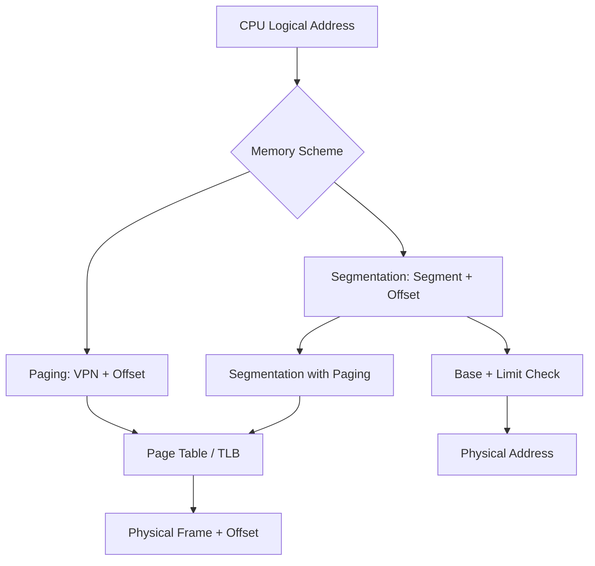

# LEC08 — Memory Management｜V2 Knowledge Consolidation

> **完整教學草稿，不是已驗證定稿。** 本文件逐頁對照取得的 78 頁講義。所有「p.」指 PDF 實際頁序。圖形密集頁的圖中數值須以原始 PDF 視覺核對；沒有假裝從圖形讀出未驗證的資料。既有 NYCU_OS 學習紀錄是歷史脈絡，不等於本次重新查證原始碼。

## 學習目標與路徑

1. 辨認三種 address binding、logical/physical address 及 MMU。
2. 分辨 dynamic loading / linking、swapping 與 allocation 的不同層次。
3. 手算 paging、TLB EAT、多層頁表與 segmentation。
4. 比較 page table 結構、保護、共享與碎裂問題。
5. 在適當節點回訪 LR04、Foundation F10、HW01 與 LR05，而非僅附上連結。

## 一頁式觀念地圖

## 逐頁講義整理（78/78 頁）

### A｜背景、位址繫結、動態載入與連結（pp. 1–18）

- **p.01 — Department of Computer Science**：封面：NYCU Operating Systems Lecture 08，Memory Management。
- **p.02 — Course Schedule**：課程表將 Lec08 排在 Lec09 Virtual Memory 前；對應 HW01。
- **p.03 — Overview**：全章六大主題：背景、Swapping、Contiguous Allocation、Paging、Segmentation、Segmentation with Paging。
- **p.04 — Background**：CPU 直接存取主記憶體／暫存器；多程式併存與磁碟換入換出是記憶體管理動機。
- **p.05 — Outline**：四條主線：位址繫結、載入與連結、Swap、記憶體配置。
- **p.06 — Multistep Processing of a User Program**：圖示描述 source → compile → link → load → execution 的多階段處理；需看原圖辨認箭頭。
- **p.07 — Address Binding – Compile Time**：Compile-time binding：絕對位址在編譯時確定；起始位置改變通常需重編。
- **p.08 — Address Binding – Load Time**：Load-time binding：relocatable code 在載入時決定實際位置；移動通常需重新載入。
- **p.09 — Address Binding – Execution Time**：Execution-time binding：執行時使用 logical address，靠 MMU 動態轉換。
- **p.10 — Memory-Management Unit (MMU)**：MMU 利用 relocation/base 類機制把虛擬位址映射至實體位址。
- **p.11 — Logical vs. Physical Address**：Logical address 由 CPU 產生；physical address 是記憶體系統使用的位址。
- **p.12 — Outline**：本頁重述四條課程主線。
- **p.13 — Dynamic Loading**：Dynamic loading：不必在一開始把所有程式模組都載入；依呼叫需求載入。
- **p.14 — Dynamic Loading Example in C**：以 C 動態函式庫 API 示範執行期載入與查詢符號；需區分載入與連結。
- **p.15 — Dynamic Loading**：圖示比較函式 B、C 被呼叫前後的磁碟映像與記憶體內容。
- **p.16 — Static Linking                                                       Memory**：Static linking：程式與函式庫於連結階段合併；執行檔較獨立但可能重複。
- **p.17 — Memory**：Dynamic linking：stub 與執行期連結器讓共用函式庫延後解析。
- **p.18 — Review Slides (1)**：Review (1)：address binding、logical/physical、dynamic/static loading 與 linking。

### B｜Swapping 與連續記憶體配置（pp. 19–29）

- **p.19 — Outline**：課程轉場至 swapping。
- **p.20 — Swapping**：Swapping：程序可暫時搬至 backing store，再回主記憶體續執行。
- **p.21 — Swapping (cont’d)**：Swap-in 位置與 address binding 時機有關；execution-time relocation 較彈性。
- **p.22 — Process Swapping to Backing Store**：Swap 耗時主要受搬運資料量與傳輸時間影響。
- **p.23 — Outline**：課程轉場至 allocation。
- **p.24 — Contiguous Memory Allocation**：連續配置主題封面。
- **p.25 — Memory Allocation**：Fixed partition：記憶體切成固定區塊；程序占用一個分割區。
- **p.26 — Multiple Partition (Variable-Size) Method**：Variable partition：從 free holes 中找足夠大的區塊，釋放時可合併相鄰 holes。
- **p.27 — Dynamic Storage Allocation Problem**：First-fit、best-fit、worst-fit 的選洞規則與搜尋成本。
- **p.28 — Fragmentation                                                   External**：Internal fragmentation 是已配置區塊內浪費；external fragmentation 是可用空洞分散。
- **p.29 — Review Slides (2)**：Review (2)：swapping、固定／可變分割、配置演算法、碎裂與 compaction。

### C｜Paging、Address Translation、TLB（pp. 30–43）

- **p.30 — Non-Contiguous Memory Allocation — Paging**：非連續配置：Paging 主題封面。
- **p.31 — Paging Concept**：Physical memory 切成 frames；logical memory 切成同大小 pages。
- **p.32 — Paging Example**：Page table 記錄 page → frame 對應。
- **p.33 — Address Translation Scheme**：Logical address = page number + offset。
- **p.34 — Address Translation Architecture**：1KB page、page 2→frame 5、offset 20：physical address = 5×1024+20 = 5140。
- **p.35 — Address Translation**：Page 數與 frame 數不必相同；虛擬空間與實體容量分離。
- **p.36 — Free Frames**：Free frames 圖示：配置時從空閒 frame 選擇並更新 page table。
- **p.37 — Page / Frame Size**：Page/frame 大小通常為 2 的冪；位址拆分由 offset bit 數決定。
- **p.38 — Paging Summary**：Paging 讓程式的邏輯記憶體觀點與實際 frame 位置分離。
- **p.39 — Implementation of Page Table**：Page table 在記憶體，PTBR 指向 page table；額外存取造成效能負擔。
- **p.40 — Associative Memory**：Associative memory 透過內容平行比對，為 TLB 提供硬體基礎。
- **p.41 — Translation Look-aside Buffer (TLB)**：TLB 快取頁表轉譯；不同 address space 切換時需處理舊轉譯。
- **p.42 — Effective Memory-Access Time**：TLB search 20ns、memory 100ns；70% hit 得 150ns，98% hit 得 122ns。
- **p.43 — Review Slides (3)**：Review (3)：page/frame、PTBR、位址轉譯、記憶體存取次數、TLB。

### D｜保護、共享與頁表結構（pp. 44–59）

- **p.44 — Memory Protection**：Page table protection bits 可限制 read/write；需與合法性位元區分。
- **p.45 — Valid-Invalid Bit Example**：Valid-invalid bit 判定頁表項是否可用；未使用 entries 也可能造成表格浪費。
- **p.46 — Shared Pages**：共享可重入 code pages，避免多個程序複製相同只讀程式碼。
- **p.47 — Shared Pages by Page Table**：透過不同程序的 page table 指向相同 frame；圖例有共享位址配置條件。
- **p.48 — Page Table Memory Structure**：單層 page table 對大虛擬空間可能很大，促使分層與替代結構。
- **p.49 — Hierarchical Paging**：32-bit VA、4KB page：10+10+12 的 two-level page table；未命中 TLB 時可需三次記憶體存取。
- **p.50 — Two-Level Page Table Example**：圖示說明外層與內層 page index 的切分。
- **p.51 — Two-Level Address Translation**：圖示為 two-level address translation 的逐層查表。
- **p.52 — Two-Level Page Table Translation Example**：圖示為 two-level translation 範例，需對照原圖表值。
- **p.53 — 64-bit Address**：64-bit address 若沿用過大的 outer table 會昂貴；多層分解降低單表大小但增加查表層數。
- **p.54 — Hashed Page Table**：Hashed page table：以 virtual page number 雜湊定位 bucket，處理大位址空間。
- **p.55 — Hashed Page Table Address Translation**：圖示展示 hashed page table 逐 bucket 比對的流程。
- **p.56 — Improved Hashed Page Table Implementation**：圖示展示 improved hashed page table 結構。
- **p.57 — Inverted Page Table**：Inverted page table 以整體 physical frames 為主建立表，而非每程序一份完整 virtual page table。
- **p.58 — Inverted Page Table Addr Translation**：圖示展示 inverted page table 的查找與轉譯。
- **p.59 — Review Slides (4)**：Review (4)：protection、valid bit、hierarchical/hash/inverted、shared pages。

### E｜Segmentation 與 Segmentation with Paging（pp. 60–76）

- **p.60 — Non-Contiguous Memory Allocation — Segmentation**：Segmentation 主題封面。
- **p.61 — Segmentation**：Segmentation 以程式員的邏輯單位（如 code/data/stack）表示記憶體。
- **p.62 — Logical View of Segmentation**：圖示展示 segment 為長度可變的邏輯區段。
- **p.63 — Segmentation Table**：Logical address=(segment number,offset)；segment table 有 base/limit，STBR/STLR 管理表。
- **p.64 — Segmentation Hardware**：若 offset 越過 limit 則非法；合法時 physical=base+offset。
- **p.65 — Address Translation Comparison**：比較 page entry(frame) 與 segment entry(base,limit)；固定頁大小對比可變 segment 長度。
- **p.66 — Example of Segmentation**：Segmentation 計算圖例，需依原圖逐段核對 base 與 limit。
- **p.67 — Sharing of Segments**：共享 segment 的圖例。
- **p.68 — Protection & Sharing**：Segmentation 可對每段設定 read-only 等權限，並可共享。
- **p.69 — Segmentation with Paging**：Segmentation with Paging 主題封面。
- **p.70 — Basic Concept**：先依 segment 組織 logical address，再以 paging 安排 physical frames。
- **p.71 — Address Translation**：Segment unit 將 logical address 轉 linear address，再由 paging unit 轉 physical address。
- **p.72 — Example: The Intel Pentium**：Pentium 案例使用 private/shared segmentation；屬歷史架構案例。
- **p.73 — Intel Pentium Segmentation**：Pentium segment descriptor 描述 base 與 length。
- **p.74 — Intel Pentium Paging (Two-Level)**：Pentium two-level paging 與 4KB/4MB page 選擇；屬特定架構案例。
- **p.75 — Example Question**：綜合練習：512B physical、32B page、8 segments、logical hex 448；投影片給出 linear/physical bit string，表格須看原圖。
- **p.76 — Review Slides (5)**：Review (5)：Paging vs Segmentation 比較，及 paged segmentation。

### F｜延伸閱讀與結語（pp. 77–78）

- **p.77 — Reading Material & HW**：Reading Material / HW：Chap 8 與 problem set。
- **p.78 — Q&A**：Q&A 結尾。

## 核心推導與可重算例題

### Address Binding（pp.7–11）

| 時機 | 產生的位址概念 | 搬移時的代價 | 需要 MMU 動態轉譯？ |
|---|---|---|---|
| Compile time | Absolute code | 通常重新編譯 | 不以此為必要 |
| Load time | Relocatable code | 重新載入／重定位 | 不以此為必要 |
| Execution time | Logical/virtual address | 可在執行期映射 | 是 |

**不要混淆**：Dynamic *loading* 是「何時把程式模組載入」，Dynamic *linking* 是「何時解析函式庫符號」，Execution-time *binding* 是「每次存取位址如何映射」。三者不是同義詞。

### Contiguous Allocation（pp.25–29）

假設空洞為 `[100, 500, 200, 300, 600] KB`，請求 `212 KB`：First-fit 選 500、Best-fit 選 300、Worst-fit 選 600（**此為自編練習，非投影片例題**）。比較剩餘空洞後，說明外部碎裂不等於「總空閒容量不足」。Compaction 需要能安全重定位的條件。

### Paging（pp.31–38）

若 page size = 2^d，虛擬位址 `VA`：

- `VPN = VA // PageSize`
- `offset = VA % PageSize`
- `PA = PFN × PageSize + offset`

**講義 p.34：** `PageSize=1024 B, VPN=2, offset=20, PFN=5`，所以 `PA=5×1024+20=5140 B`。13-bit logical address 的 page number 是 3 bits，offset 是 10 bits。必須注意 `VPN=2` 並不代表 `PFN=2`。

**NachOS HW01 變體（歷史課程參數，非投影片數值）：** `PageSize=128`，`VA=816`，`VPN=6`、`offset=48`；若 PTE[6].physicalPage=9，`PA=9×128+48=1200`。此處 PFN=9 是**假設值**，不是當時 GDB 證據。

### TLB Effective Memory Access Time（pp.39–43）

在投影片模型下，TLB lookup=20ns，RAM access=100ns，TLB hit 一次 RAM、miss 兩次 RAM：

`EMAT = h×(20+100) + (1−h)×(20+100+100)`

- `h=0.70` → `0.7×120 + 0.3×220 = 150 ns`
- `h=0.98` → `0.98×120 + 0.02×220 = 122 ns`

**適用條件**：未納入 page fault、cache 層級、TLB miss page walk 變體。不可將這個模型直接當作現代 CPU 的完整延遲模型。

### Hierarchical Page Table（pp.48–53）

32-bit VA、4KB pages：12-bit offset，剩餘 20 bits 分為 10-bit outer + 10-bit inner。若每 PTE 4B，單一二層表 1024 entries × 4B = 4KB；在無 TLB 且二層表都需讀取的教學模型中，兩次查表加一次資料存取，共 3 次 RAM access。p.53 以 64-bit 例子說明 outer table 過大時再增加層級的權衡。

### Segmentation（pp.61–76）

Segment table entry `(base, limit)`；給定 `(s, offset)`，先檢查 `s < STLR`、`offset < limit[s]`，再計算 `PA = base[s] + offset`。與 paging 不同，segmentation 反映可變長度邏輯單位，容易有 external fragmentation；paging 固定大小可有 internal fragmentation。Segmentation with paging 是先產生 linear address，再經 page table 轉 physical address（p.71）。

p.75 題目涉及圖中 segment/page table；講義文字給出 `linear=010111110`、`physical=001011110`。**不得只憑這兩個答案反推表項，需先核對原圖**。

## 五組 Review Slides：完整問答（對應 p.18、29、43、59、76）

### Review 1（p.18）

1. **三種 binding？** Compile-time（固定 absolute）、load-time（載入重定位）、execution-time（MMU 動態轉譯）。
2. **Logical vs physical？** CPU 產生 logical/virtual；實體記憶體以 physical address 定位；MMU 在兩者之間映射。
3. **Dynamic vs static loading？** Dynamic 按需求載入模組；static 提前載入。不要與 linking 混淆。
4. **Dynamic vs static linking？** Dynamic 在執行期解析／載入共用函式庫；static 於連結階段合併所需程式碼。

### Review 2（p.29）

1. **Swapping？** 將程序記憶體映像暫移 backing store，之後再載入；搬運時間與資料量密切相關。
2. **Contiguous allocation？** 程序占一段連續實體區域；fixed partition 易內部碎裂，variable partition 易外部碎裂。
3. **First/Best/Worst-fit？** 第一個足夠大／最小足夠大／最大空洞；策略不同不保證最佳全域利用率。
4. **Fragmentation / Compaction？** Internal 在已配置區塊內，external 為分散空洞；compaction 透過搬移合併空閒空間但有成本與限制。

### Review 3（p.43）

1. **Page / frame？** 相同大小的虛擬／實體固定區塊；常見大小以 2 的冪表示，實際大小由硬體／OS 決定。
2. **Page table？** 依 VPN 找 PFN，再保留 offset。
3. **PTBR 何時更新？** Address space 切換時需指向當前程序的表；實際實作可能採用其他寄存器／TLB 策略。
4. **每次 reference 幾次 RAM？** 單層表無 TLB 的簡化模型為查表一次＋資料一次；TLB hit 可省查表 RAM access。
5. **Associative memory/TLB？** 以快取的 VPN→PFN 轉譯減少 RAM 查表。

### Review 4（p.59）

1. **Protection？** PTE 可有 read/write 等權限；非法存取應被拒絕。
2. **Valid/invalid？** 表示轉譯項的有效性；與 readOnly 不同。
3. **頁表結構？** Hierarchical 以多層表節省稀疏區域；hashed 依 VPN 雜湊；inverted 依 physical frames 建表。
4. **Shared pages？** 多程序的 PTE 指向同一 physical frame，通常搭配唯讀／可重入 code 等條件。

### Review 5（p.76）

1. **Paging vs segmentation？** Paging 固定區塊、主要按 frame 管理；segmentation 可變長、按程式邏輯單位管理。
2. **碎裂？** Paging 典型 internal，segmentation 典型 external。
3. **表項？** Paging VPN→PFN；segmentation segment→(base,limit)。
4. **Paged segmentation？** 先以 segment 取得 linear address，再以 paging 映射到 physical frame。

## Knowledge Connections：學習中即時連結

| ID | 本章位置 | 舊教材 | 為何要回訪 | 再學習行動 |
|---|---|---|---|---|
| KC-LEC08-01 | pp.9–11 | LR03 Process / F10 Context Switch | 執行時轉譯與切換 address space 相依 | 追 `RestoreState()` 並畫 pageTable 切換 |
| KC-LEC08-02 | pp.31–38 | HW01 FrameTable | Page→Frame 是實際 frame 配置的基礎 | 重算 VA→PA，對照 PTE 的 PFN |
| KC-LEC08-03 | pp.39–43 | LR05 Virtual Memory | TLB miss 與 page fault 不是同一事件 | 比較 TLB miss、invalid PTE、page fault |
| KC-LEC08-04 | pp.44–47 | HW01 / FS02 | Read-only / shared pages 與實際檔案載入有關 | 對照 NOFF code/data 與 readOnly 欄位 |
| KC-LEC08-05 | pp.48–59 | LR04 Page Table | 多層／反向頁表與 NachOS 線性 page table 是不同設計 | 比較查表成本與資料結構 |

上述是**候選教學關聯**，不能在沒有讀取既有教材文件與實際程式碼時標記 `VERIFIED`。

## V2 分階段理解驗收（先作答再核對）

1. 為什麼 execution-time binding 需要 MMU？
2. 何時 dynamic loading 與 dynamic linking 會分別發生？
3. 空洞 200KB、100KB、300KB，請求 90KB，三種 fit 選哪個？
4. 4KB page、VA=0x2345、VPN=2→PFN=7，求 PA。
5. 何以 TLB hit ratio 上升能降低 EMAT？模型的限制是什麼？
6. 32-bit VA + 4KB pages 的 10/10/12 如何推導？
7. Segment base=800、limit=300，offset=299/300 哪個合法？
8. TLB miss 與 page fault 是否必然同時發生？說明。

自我檢查答案

1. 執行中每次 logical address 都可能需要轉譯。 2. 模組使用時載入；符號於連結解析時處理。 3. First=200、Best=100、Worst=300。 4. `0x7345`。 5. 減少查表 RAM access；未含 fault/cache 等。 6. offset=12、剩20，拆10+10。 7. 299合法、300非法。 8. 不必然；TLB miss 可由有效 PTE 補入。

## 來源、限制與下一輪工作

- **SOURCE VERIFIED (lecture text)**：本次已讀取 `lec08.pdf` 的文字層，78 頁逐頁標題與五組 Review 題目。
- **PENDING VISUAL REVIEW**：p.6、15、36、50–52、55–58、62、66–67、71–75 等圖示頁需對照 PDF 圖像確認箭頭、表值、標註。
- **PENDING CODE VERIFICATION**：NYCU_OS 現行 NachOS 原始碼、行號、實測輸出尚未重新讀取；請見 V3。
- **PENDING HISTORY VERIFICATION**：LR04 原三份 README/EVIDENCE/TERMINOLOGY 與理解驗收細節尚未直接讀取；不能據此聲稱已驗證。
