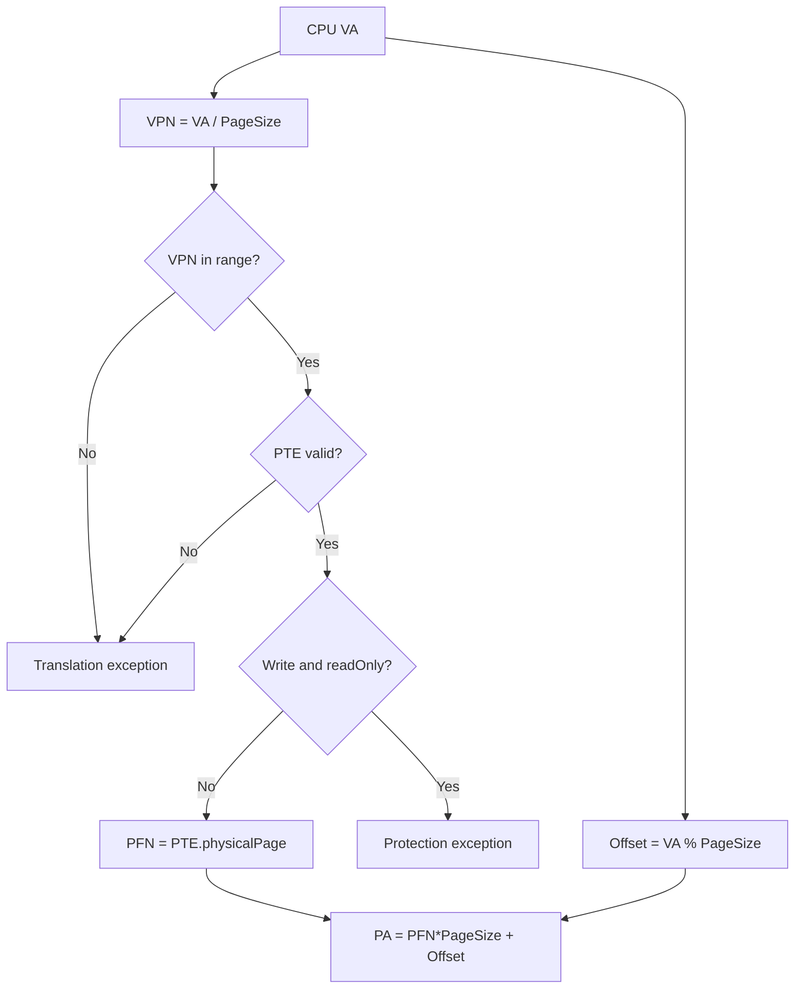
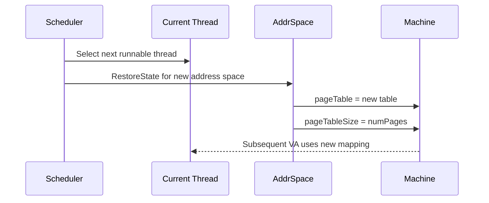

# LEC08 — Memory Management｜V3 Code-First Deep Dive

> **Code-first 完整教學草稿。** 下列所有未讀取到使用者現行 repo 的程式片段均明確標示 `PSEUDOCODE` 或 `HISTORICAL USER-SUPPLIED SNIPPET`；絕不冒充本次 `VERIFIED SOURCE`。PDF 的理論對應頁碼見 V2。

## 0. VS Code Code-Walk 路線

建議從使用者 HW01 學習副本開始：`/home/copylearning/nycu-os/NYCU_Learning/Homework/HW01/starter/code`（**歷史路徑，需先確認仍存在**）。

```bash
cd /home/copylearning/nycu-os/NYCU_Learning/Homework/HW01/starter/code
code .
rg -n 'Translate\(|RestoreState\(|SaveState\(|FrameTable|PageFaultException' machine userprog threads
```

依序閱讀：`machine/translate.h` → `machine/translate.cc` → `userprog/addrspace.h/.cc` → `threads/kernel.h/.cc` → `threads/scheduler.cc` → `userprog/exception.cc`。以 VS Code 搜尋／跳轉為主；GDB 非預設。

## 1. Source Map（Lecture → NachOS）

| PDF | 概念 | 待核對檔案／函式 | 證據狀態 |
|---|---|---|---|
| pp.9–11 | Execution-time binding | `AddrSpace::RestoreState`, `Machine::Translate` | PENDING REOPEN |
| pp.31–38 | VPN / PFN / offset | `machine/translate.cc`, `TranslationEntry` | PENDING REOPEN |
| pp.36–38 | Free frames | HW01 `FrameTable::Allocate/Release` | PENDING REOPEN |
| pp.39–43 | TLB / PTBR | `Machine::Translate`, `RestoreState` | IMPLEMENTATION-DEPENDENT |
| pp.44–47 | Valid/readOnly | `TranslationEntry`, `ExceptionHandler` | PENDING REOPEN |
| pp.48–59 | Page-table structures | 比較 NachOS 線性 page table 與講義多層／hashed／inverted | CONCEPTUAL COMPARISON |
| pp.61–76 | Segmentation | 教學用 C 模擬；不宣稱 NachOS 使用 segmentation | TEACHING EXAMPLE |

## 2. V3-A：從虛擬位址到實體位址（pp.31–38）

```cpp
// PSEUDOCODE: illustration, NOT copied from NachOS
unsigned vpn = virtualAddress / PageSize;
unsigned offset = virtualAddress % PageSize;
if (vpn >= pageTableSize || !pageTable[vpn].valid) {
    return AddressTranslationFailure;
}
if (writing && pageTable[vpn].readOnly) {
    return ProtectionFailure;
}
unsigned physicalAddress = pageTable[vpn].physicalPage * PageSize + offset;
```

**逐行資料流**：CPU 產生 `virtualAddress` → 以 `PageSize` 拆 VPN/offset → VPN 做 bounds check → `pageTable[vpn]` 讀 valid/readOnly/PFN → 保留 offset → 得 physical address。注意實際 NachOS 的例外型別、對齊與讀寫參數必須以現行 `Machine::Translate()` 為準。



**手算對照**：講義 p.34 的 1KB/5/20 → 5140；NachOS 學習參數 128B、VA=816 → VPN6/offset48，PFN 必須由真實 PTE 決定，不能從 VA 猜測。

## 3. V3-B：FrameTable / AddrSpace 生命週期（pp.31–38）

```cpp
// PSEUDOCODE: HW01 intent, not a verbatim implementation
for (unsigned vpn = 0; vpn < numPages; ++vpn) {
    int pfn = frameTable.Allocate(/* mapping for vpn */);
    pageTable[vpn].virtualPage = vpn;
    pageTable[vpn].physicalPage = pfn;
    pageTable[vpn].valid = true;
}
// On destruction, release owned frames and page table.
```

**要追的狀態**：`RemainSize` → frame 被佔用 → `TranslationEntry.physicalPage` → 程序結束 `Release` → available frames 回升。避免把講義的 inverted page table 直接等同於 HW01 的 FrameTable：前者是位址翻譯資料結構，後者可能是 frame allocation 管理器；必須依原始碼驗證。

**回訪 HW01**：歷史學習紀錄提及 `GetFreeFrame`, `Allocate`, `Release`, `GetAvailableFrames` 與 NOFF page-by-page loading，但未在本次重新開啟 code；將精確函式簽章、行號、測試 log 留作 evidence TODO。

## 4. V3-C：Context Switch 與 Address Space（pp.9–11, 39–43）

歷史使用者曾提供下列 `AddrSpace::RestoreState()` 片段（**HISTORICAL USER-SUPPLIED SNIPPET，非本次 repo 重讀**）：

```cpp
void AddrSpace::RestoreState()
{
    kernel->machine->pageTable = pageTable;
    kernel->machine->pageTableSize = numPages;
}
```

**解釋**：當 CPU 轉向另一 address space，模擬 machine 使用的頁表指標與長度要同步切換。此片段是 NachOS software page table 路徑；**不可**從它直接推論實際硬體 PTBR 暫存器或 TLB flush 已實作。



**待查證**：`Scheduler::Run()`、`SWITCH`、`RestoreUserState` 的實際呼叫次序依使用者版本為準；上圖表示資料依賴，不宣稱是逐函式精確 trace。

## 5. V3-D：Protection、Page Fault、TLB Miss（pp.41–47）

`valid` 與 `readOnly` 是不同條件。`valid=false` 的處置是否等於可修復的 demand page fault，取決於該版 NachOS 是否有 demand paging handler；不能只憑 PTE bit 判定。

| 狀況 | 可能結果 | 需驗證來源 |
|---|---|---|
| TLB miss + PTE valid | 可從頁表補轉譯，未必 page fault | machine TLB 路徑 |
| PTE invalid | 可能拋 exception，是否 demand load 依 handler | `translate.cc`, `exception.cc` |
| Write + readOnly | Protection fault | `translate.cc` |
| VPN out of range | Address error | `translate.cc` |

**跨教材再學習**：LR05 的 demand paging 是另一層機制；請對照 exception handling，而不是把 TLB miss 和 page fault 當同一事件。

## 6. V3-E：多層、Hashed、Inverted Page Tables（pp.48–59）

**二層表 PSEUDOCODE**：

```cpp
// 32-bit VA, 4KB page, 10/10/12 split (illustration)
unsigned p1 = (va >> 22) & 0x3ff;
unsigned p2 = (va >> 12) & 0x3ff;
unsigned off = va & 0xfff;
PTE entry = outer[p1]->inner[p2];
unsigned pa = entry.pfn * 4096 + off;
```

- Hierarchical：按層查表，避免為稀疏 VA 全量配置單層表。
- Hashed：由 VPN hash 找 bucket，再比對 tag／chain。
- Inverted：以 physical frame 為索引，需辨識 process ID + virtual page 等資訊。
- **NachOS 對照**：若當前版本 `pageTable[vpn]` 直接索引，是 linear table；不得宣稱它已實作上述三種結構。

## 7. V3-F：Segmentation 與 Paged Segmentation（pp.61–76）

```c
/* TEACHING EXAMPLE, not NachOS source */
#include <stdbool.h>
#include <stddef.h>
typedef struct { unsigned base, limit; } Segment;
bool translate_segment(const Segment *tab, size_t count,
                       unsigned seg, unsigned off, unsigned *pa) {
    if (seg >= count || off >= tab[seg].limit) return false;
    *pa = tab[seg].base + off;
    return true;
}
```

**演算**：segment index bounds → limit check → base+offset。若再加 paging：`(seg,off)` → linear address → `(VPN, page offset)` → physical address。這是講義 p.70–71 的兩段映射；不能把 `base+offset` 當成 paged segmentation 的最後一步。

## 8. V3-G：動態載入、Swapping 與程式載入（pp.13–22）

以使用者 HW01 NOFF loader 作比較：磁碟可執行檔的 code/initData/uninitData 如何配置到 physical frames？這是 **load program image**；講義的 **dynamic library loading** 與 **whole-process swapping** 不是同一個操作。追蹤 `AddrSpace` 建構、NOFF header、`ReadAt` 與 frame zero-fill，標出每個步驟讀寫的是 disk file、kernel buffer、或 simulated main memory。實際 `ReadAt` 呼叫參數與逐頁拷貝邏輯待現行 repo 核對。

## 9. 依 VS Code 執行的查證清單

```bash
# 只讀定位；不修改原始碼
rg -n 'class TranslationEntry|struct TranslationEntry|virtualPage|physicalPage|readOnly' machine userprog
rg -n 'Machine::Translate|AddrSpace::RestoreState|AddrSpace::~AddrSpace' machine userprog
rg -n 'FrameTable|GetAvailableFrames|RemainSize|Release' threads userprog
rg -n 'PageFaultException|ReadOnlyException|AddressErrorException' machine userprog
rg -n 'Scheduler::Run|RestoreUserState|RestoreState' threads userprog
```

將每一項查證結果整理至 `EVIDENCE.md`：`source path`、commit SHA、實際行號、關鍵程式碼、Call Flow、實測輸出、PASS/FAIL/PENDING。**本次未執行上述命令，不填造證據。**

## 10. V3 理解驗收（需畫流程或追資料）

1. 在 `Translate()` 中標出 VPN/offset 計算、PTE bounds、valid、readOnly、PFN、PA 六個點。
2. 128B page、VA=816、PTE[6].physicalPage=9 時，逐步列出 VPN、offset、PA。
3. Context switch 後若仍使用舊 pageTable，哪一類錯誤可能出現？用兩個 process 舉例。
4. FrameTable allocation 與 inverted page table 的資料結構目的是否相同？
5. 畫出 NOFF load → frame allocate → pageTable update → execute → release 的狀態圖，指出哪個是歷史已知、哪個待驗證。
6. 說明為何 TLB miss 不必然 page fault，並指出要查證哪個 handler。
7. 32-bit VA 0x12345678 的 10/10/12 分割如何用位元遮罩求出？
8. 實作 `translate_segment` 的邊界測試（offset=limit−1、offset=limit）。

### V3 QA 檢核基準

- 必須提供計算過程與資料結構，不只答案。
- 凡引用現行 NachOS 行號與函式順序，須有 repo 證據。
- 若實際版本與教學 pseudocode 不同，以實際版本為準並註明差異。
- QA 完成需由 ChatGPT + Human 確認，工程發布不得冒稱已完成學習。

## 11. 三格式發布與 Obsidian

- **MD Source**：保留此 Markdown 與 V2 作 Single Source of Truth，連結使用相對路徑及穩定 material_id。
- **HTML**：MkDocs strict build；頁碼錨點、Mermaid、公式、code fence、內部連結須有效。
- **PDF**：從 Markdown 產生，檢查中文字型、頁碼、目錄、code wrap、圖表與可點擊連結。
- **Obsidian**：匯出時轉為可解析 WikiLinks，並納入 `RELEARNING_SUPPLEMENTS` 節點；避免直接破壞 MkDocs 原始 Markdown 連結。
- **三格式狀態**：目前僅 MD 草稿已建立；HTML/PDF/Obsidian Vault 實際建置與 E2E 驗證 **PENDING**。

## 12. Evidence Boundary

`SOURCE VERIFIED` 僅限本次講義文字與頁碼；`HISTORICAL USER-SUPPLIED SNIPPET` 僅代表過往使用者貼出的 code；`PSEUDOCODE` 是教學示意；`PENDING REOPEN` 需在 NYCU_OS 原始碼庫核實。不得混用。
